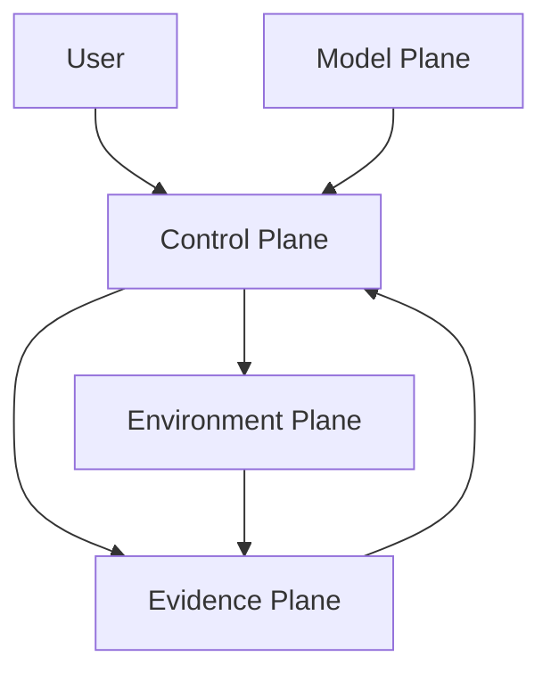

# Design Contract

## 1. Problem

长任务 Agent 的失败通常不是单轮生成质量，而是：上下文不断膨胀、模型把 proposal 当成已提交副作用、
重试重复扣款、worker 崩溃丢状态、人工验收无法恢复，以及“模型说完成”没有证据。

本项目把问题收敛为：

```text
Model proposal -> Harness decision -> Environment effect -> Evidence
```

## 2. Four planes



### Model plane

`ModelAdapter` 只返回 `ModelResponse`。返回值可以是文本、tool call、subagent request 或
`NeedUser`，不能直接写 `TaskState`、领域库或文件。

### Control plane

`Runtime` 编译 context、检查身份和预算、调用模型、执行工具、处理 gate、提交事件并决定是否完成。
`Executor` 以 Canonical Manifest 为唯一拓扑来源，拥有 node state、attempt、lease 和 artifact contract。

### Environment plane

`ToolRuntime`、MCP server 和 policy engine 是副作用边界。每个工具都声明 schema、scope、
副作用类型、timeout、retry 和幂等要求。

### Evidence plane

SQLite 中的 task、immutable event、checkpoint、memory、idempotency、lease 和 feedback 是控制面事实。
事件哈希链可以在重放时发现篡改；artifact/evidence 绑定 producer node/attempt。

## 3. Agent Loop

```text
validate identity
  -> create task + genesis event
  -> compile stable/dynamic context
  -> model complete/stream
  -> charge token/cost budget
  -> tool / subagent / user gate
  -> persist observation
  -> structured output + verifier
  -> episodic memory + checkpoint
	-> final answer + replay/evaluation/feedback
```

### 3.1 Durable lifecycle journal

实现的 event journal 对齐 DeepSeek Harness 的 `turn/step` 语义，并把 Shannon 的
`workflow/agent/tool` 观测拆成可续传的事件：

```text
TASK_ACCEPTED -> PLAN_COMPILED
  -> TURN_STARTED -> STEP_STARTED -> CONTEXT_COMPILED
  -> MODEL_REQUESTED -> MODEL_PROPOSED
  -> TOOL_INVOKED -> TOOL_OBSERVED -> TOOLS_EXECUTED
  -> STEP_COMPLETED -> TURN_COMPLETED
  -> TASK_COMPLETED / TASK_FAILED / USER_GATE_OPENED
```

`MODEL_REQUESTED` 保存 provider projection（messages、tool schema、response schema、model
参数和 prefix key），`MODEL_PROPOSED` 保存响应摘要、tool call、gate 和 usage。因而
“模型看到了什么”和“模型提议了什么”都能从日志重放，而不是只剩最后一句答案。每个事件
payload 同时携带 `_state_digest`，并和同事务写入的 checkpoint 绑定；`ReplayState` 会同时
校验 hash chain、checkpoint digest 和 materialized state。

任何循环都必须满足 `max_steps`、`max_tool_calls` 和 loop fingerprint 限制。模型输出是数据，
`TASK_COMPLETED` 只能由 runtime 在 verifier 通过后追加。

## 4. Durable commit

`Store.CommitStateEvent` 在一个 SQL transaction 中完成：

1. 检查 task version/sequence；
2. 计算 `event_hash = SHA256(previous_hash, sequence, event_type, canonical_payload)`；
3. 插入 event；
4. 更新 materialized state/version；
5. 写 checkpoint。

重放要求 sequence 连续、`previous_hash` 链接正确且 hash 重算一致。生产版可把同一接口替换为
PostgreSQL + serializable transaction，调用方不改变协议。

HTTP event projection 支持 `Last-Event-ID` 或 `?since=<sequence>`，`?follow=1` 会轮询追加的
事件直到 task 进入终态。当前 Go 原型使用一个 SQLite journal；它证明提交和续传协议，生产
版再把实时 fan-out 拆到 Redis/NATS，把重要事件写入 PostgreSQL/CAS，保留 Shannon 的两级
事件保留策略。

## 5. Reference alignment

本项目借鉴两个参考项目的边界，不声称复刻其实现：

- **DeepSeek Harness**：采用 append-only session 事件作为模型上下文来源，明确区分 durable
  `turn/step/tool` 事件和 live extension seam，并通过 ModelAdapter、ToolRegistry、Memory 和
  Session Store 保持 provider 可替换。Go 版本用接口和 SQLite 事务表达同一控制面原则。
- **Shannon**：借鉴 task/workflow API、live SSE + persistent event log、预算/超时/重试、
  human gate、replay 和长任务 orchestration。DAG 只负责长任务 ready/lease/attempt/artifact/
  UAT，不能绕过 Harness 的 policy 和 evidence。

本地 fixture 仍是 scripted model 和单进程 SQLite；它是协议与故障语义的可复现实验，不是
线上吞吐、分布式一致性或真实模型效果的结论。

## 6. Tool and side effects

```text
schema -> auth scope/filter -> policy -> idempotency lookup
      -> timeout/retry -> result classification
      -> durable observation
```

超时不等于失败：有副作用工具返回 `UNKNOWN` 并写入幂等账本，后续操作必须对账或使用相同 key 重放。
路径、工具、网络和 secret profile 在 `ExecutionPolicy` 边界检查；进程级 sandbox 是生产替换项。

## 7. Context, cache, memory

- stable prefix：system/developer/tool schema/policy；prefix key 同时绑定 model/revision、reasoning effort、tenant/subject、scope、policy/compiler version 和 Skill digest，并做命中、失效和 LRU 统计；
- dynamic context：goal、state、observation、memory、user response；超预算时压缩，不进入 stable prefix；
- memory：按 tenant/subject/namespace 隔离，版本和 `supersedes` 形成更新链；过期或 tombstone 记录不能回退暴露旧版本；
- reasoning：只保留 plan、verifier reason、failure fingerprint 和摘要，不依赖隐藏思维链。

真实 GPU KV tensor 和 provider prompt cache 不由本地 Harness 伪造，生产适配通过 ModelAdapter 完成。

## 8. DAG execution

Canonical Manifest 的生命周期：

```text
JSON Schema -> semantic validation -> topological order
-> activation decision -> lease -> fresh attempt/context
-> runner result -> artifact/evidence acceptance
-> success / retry / rework / blocked / user gate
```

`ALL`、`ANY`、`QUORUM` 使用三值 ready decision：`READY`、`WAIT`、`BLOCKED`。retry 不复用上次
agent instance 或隐式对话；失败尝试保留，返工通过 manifest 的 `FAILED` edge 进入 diagnosis。

UAT gate 的恢复顺序是：用户 decision -> scheduler 提交 `USER_GATE_ACCEPTED` -> artifact/evidence 封存 ->
继续调度。用户拒绝进入 `FAILED`，不会被模型文本绕过。

## 9. Evaluation and evolution

Trajectory 记录 model round、tool call、retry、latency、token、cost、failure category。评测输出 success rate、
p95 和 Wilson interval；`RunAblation` 保持固定 fixture，对 baseline/candidate 做受控比较。
`EvaluatePromotion` 只晋级通过样本量、成功率、延迟和 steps guardrail 的配置，不直接改线上代码或事实。

产品反馈记录 stage/outcome/category/rating/cohort/variant，汇总完成率、drop-off、人接管和评分，形成：

```text
feedback -> failure taxonomy -> hypothesis -> offline ablation -> guarded rollout
```

## 11. ADR: language

选择 Go 的原因是控制面需要并发 worker、context cancellation、静态状态契约、race detector、标准 HTTP/SSE
和单二进制交付。模型训练或离线数据科学可以是外部系统，但当前项目运行时和测试统一为 Go。
