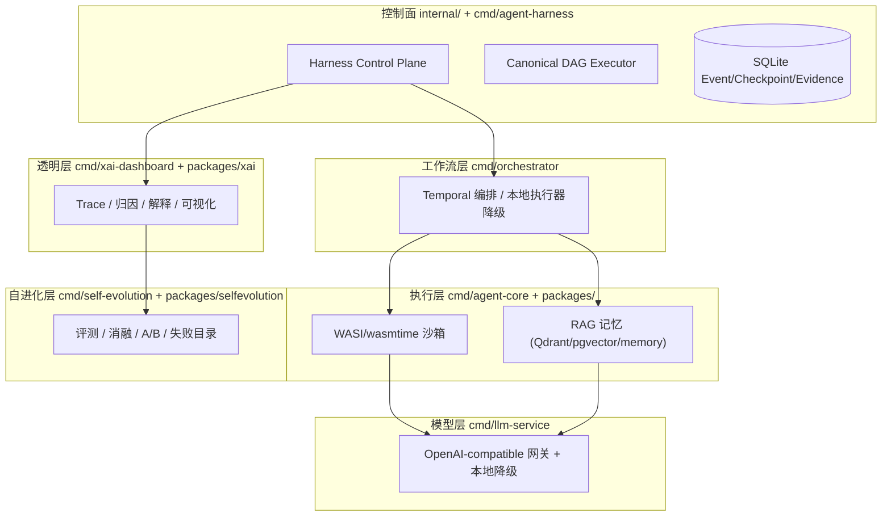
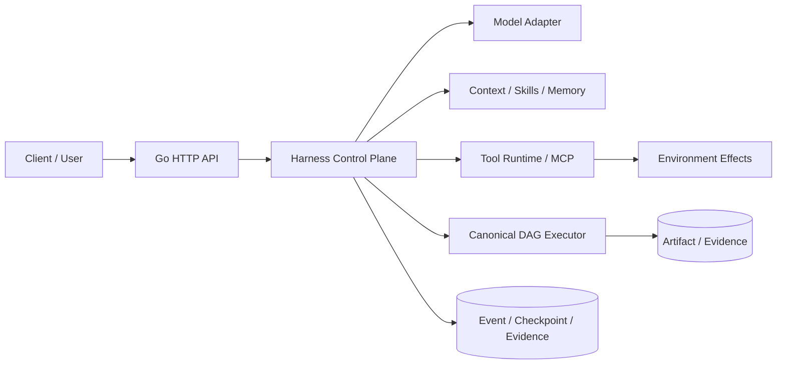

# DAG Code Agent

一个使用 Go 实现的、可恢复且可评测的 Agent Harness。项目把模型输出限定为 proposal，
由确定性运行时负责上下文编译、工具权限、副作用幂等、状态提交、人工 gate、checkpoint/replay、
DAG 调度和验收证据。

它不只是控制面：围绕一个已经可运行的 **Harness 控制面** 核心，项目按三层架构补齐了
**执行层**（WASI 安全沙箱 + RAG 记忆）、**模型层**（带降级与限流的 LLM 网关）、
**工作流层**（Temporal 编排，离线降级为本地执行器）、**透明层**（XAI 归因与可视化）
和 **自进化层**（固定数据集上的评测、消融、A/B 与失败目录）。每一层都能独立运行，
并且在外置依赖（Temporal、Qdrant、PostgreSQL、OpenAI-compatible 网关）不可达时
**优雅降级**到进程内的本地实现，而不是直接崩溃。

## 核心不变量

1. 模型只能提出文本、tool call、subagent request 或 user gate，不能直接提交状态。
2. Harness state、DAG 运行状态和证据日志分别拥有自己的数据，不互相冒充事实源。
3. 每次状态变更和事件追加在一个 SQLite 事务内完成，并形成 SHA-256 hash chain。
   事件 payload 的 `_state_digest` 同时绑定 checkpoint 和 materialized state，`ReplayState` 会校验三者一致。
4. 有副作用的工具先做 schema、scope、timeout 和 idempotency；超时结果是 `UNKNOWN`。
5. DAG 只读取 Canonical Manifest；retry 创建新的 attempt、agent instance 和 context。
6. 完成条件由 structured output、artifact contract、verifier/evidence 或 user gate 决定。

## 三层架构与可运行产物



| 二进制 | 层 | 职责 | 关键依赖 | 降级行为 |
|---|---|---|---|---|
| `agent-harness` | 控制面 | 运行时、HTTP API、事件哈希链、DAG 调度 | SQLite（内嵌） | 离线模型适配器 |
| `agent-dag` | 控制面 | DAG happy/rework/crash 场景演示 | — | — |
| `agent-core` | 执行层 | gRPC AgentService + HTTP 管理面；WASI 沙箱执行；RAG 记忆 | wasmtime、Qdrant | 内存向量库 + 本地嵌入 |
| `llm-service` | 模型层 | OpenAI-compatible complete/embeddings、限流、缓存、成本、降级 | 任意 OpenAI-compatible 网关 | 本地确定性 provider |
| `orchestrator` | 工作流层 | Temporal workflow/activity 编排，路由与优先级队列 | Temporal | 本地内联执行器 |
| `xai-dashboard` | 透明层 | 执行 trace、归因、推理解释、可视化（SSE） | — | 内置演示 trace |
| `self-evolution` | 自进化层 | 固定数据集评测、消融研究、A/B、反馈与失败目录 | 评测数据 YAML | 确定性 runner |

所有 7 个二进制由 `make build` 产出到 `bin/`，并可通过 `scripts/smoke.sh` 一键端到端验证
（全部服务离线启动、各自降级、逐项检查，当前 **PASS: 18 FAIL: 0**）。

## 核心控制面（internal/）

模型只产生 proposal，Harness 编译上下文、执行策略、提交状态并保留可重放证据。
Canonical DAG 是它面向长任务交付的调度模式，负责 ready set、lease、fresh attempt、
artifact/evidence ledger、crash recovery 和 UAT gate。



| 层 | 主要职责 | 代码 |
|---|---|---|
| Model | complete/stream、tool-call、structured output、usage、fallback | `internal/harness/model.go` |
| Harness | loop、context、plan、budget、gate、cancel/recover | `internal/harness/runtime.go`、`context.go` |
| Environment | Tool/MCP、scope、timeout、retry、idempotency、policy | `tools.go`、`policy.go` |
| Evidence | event chain、checkpoint、trajectory、evaluation、feedback | `store.go`、`evaluation.go`、`feedback.go` |
| Long task | manifest、activation、lease、attempt、artifact、UAT | `internal/dag/` |

## JD 知识点映射

| 主题 | 实现证据 |
|---|---|
| LLM API | OpenAI-compatible complete/SSE、usage、tool-call parsing、JSON Schema output |
| KV Cache | stable prefix key、命中/失效/LRU 账务；provider GPU KV 保持在模型服务边界 |
| Agent Loop | model -> tool/subagent/user -> observation -> verifier -> final |
| Tool Use | schema、scope、timeout、retry、idempotency、`UNKNOWN` |
| Reasoning | `reasoning_effort`、显式 plan/verifier、token/cost/tool budget |
| Planning | `RulePlanner` 和 Canonical DAG ready set/rework |
| Skills | discovery、版本排序、ACTIVE/DEPRECATED、scope filter（`packages/skills`） |
| MCP | initialize、capability、tools/list、tools/call、版本协商 |
| Memory | working/episodic/semantic/procedural 契约、version、expiry、forget（`packages/vector`） |
| Subagent/Multi-Agent | 隔离 context、并发 fan-out、fan-in、conflict/consensus（`packages/multiagent`） |
| Long-Horizon | checkpoint、hash replay、lease、crash recovery、fresh attempt |
| Evaluation | success、p95、Wilson CI、ablation、promotion guardrail（`packages/selfevolution`） |
| 安全执行 | WASI/wasmtime 沙箱、fuel/epoch 限制、文件系统隔离（`packages/sandbox/wasi`） |
| 可解释性 | trace 归因、推理叙事、失败归因、碳感知（`packages/xai`） |
| 权限/循环 | 工具 scope 判定、循环检测（`packages/permissions`、`packages/loopsdetect`） |
| 自进化入口 | 固定数据集上的候选 Harness 配置晋级门，不直接自改生产状态 |

## 目录

```text
cmd/
  agent-harness/       # 运行时底座 / HTTP 服务器
  agent-dag/           # DAG happy/rework/crash 演示
  agent-core/          # 执行层：gRPC AgentService + WASI + RAG
  orchestrator/        # 工作流层：Temporal 编排 / 本地执行器
  llm-service/         # 模型层：OpenAI-compatible 网关 + 降级
  self-evolution/      # 自进化层：评测 / 消融 / A/B
  xai-dashboard/       # 透明层：trace / 归因 / 可视化（内置静态 UI）
  proto/               # agent_core.proto（gRPC 契约源）
internal/
  harness/             # provider-neutral 控制面
  dag/                 # canonical manifest 校验 / 执行
  httpapi/             # JSON API 与可重放 SSE 投影
packages/
  sandbox/ (wasi/)     # 统一沙箱接口 + WASI/wasmtime 后端
  vectordb/            # Qdrant / pgvector / 内存 向量库 + RAG 管线
  embedding/           # HTTP / 本地 嵌入服务 + 工厂
  xai/                 # trace、归因、解释、碳感知、联邦学习等
  selfevolution/       # 评测、消融、A/B、反馈、失败目录
  skills/ permissions/ loopsdetect/ multiagent/ hooks/ prompt-engine/ vector/
proto/agent_core/      # 由 proto 生成的 Go/gRPC 代码
data/evaluation/       # 自进化固定数据集 (tasks.yaml)
testdata/              # hello.wasm（真实 WASI 模块）
scripts/smoke.sh       # 全栈离线端到端冒烟测试
frontend/              # React + Vite + HeroUI 控制台（控制面）
docker-compose.yml     # Temporal + Qdrant 真实基础设施（可选）
configs/               # DAG 运行时 schema 与示例 manifest
docs/                  # 设计与经验文档
```

## 快速开始

要求 Go 1.26+。

```bash
go mod download
make build        # 构建全部 7 个二进制到 bin/
make test         # 全量单测
./scripts/smoke.sh  # 全栈离线冒烟（全部服务降级运行）
```

单独运行控制面演示（不需要 API key）：

```bash
make demo    # 离线 Harness demo
make dag     # Canonical DAG happy 场景
make rework  # 让 N-VERIFY-V1 连续失败两次后收敛
```

离线 Harness demo 执行 `memory search -> artifact write -> artifact read -> structured
output -> verifier -> checkpoint/replay`。Canonical DAG demo 执行 `schema + semantics ->
ready set -> lease -> fresh attempt -> artifact/evidence -> technical verification ->
UAT pause/resume`。`make rework` 会让 `N-VERIFY-V1` 连续失败两次，再通过
`diagnosis -> implement-v2 -> verify-v2` 收敛。

### 启动全栈（离线，自动降级）

```bash
make build
./scripts/smoke.sh
```

脚本按顺序拉起并逐项验证：控制面（18080）→ 模型层（18081）→ 执行层 gRPC 18051 /
HTTP 18052 → 透明层（18030）→ 工作流层（18083）→ 自进化 oneshot。其中执行层会做一次
真实 WASI 往返：把 `testdata/hello.wasm` base64 后经 `/api/execute` 在沙箱里跑通并回传
`hello from wasi`。

### 接入真实基础设施（可选）

不带任何外置依赖时，所有服务用本地实现。要启用真实后端：

```bash
docker compose up -d        # 启动 Temporal (7233/8233) 与 Qdrant (6333/6334)
```

然后按环境变量接入：

- **orchestrator**：`TEMPORAL_HOST=127.0.0.1 TEMPORAL_PORT=7233` —— 自动从本地执行器
  切换为 Temporal workflow/activity。
- **agent-core**：`QDRANT_HOST=127.0.0.1 QDRANT_PORT=6334` —— 自动从内存向量库切换为
  Qdrant（`NewAutoVectorDB` 做 2s TCP 探测后选择）。
- **agent-core / 嵌入**：`LLM_SERVICE_ADDR=127.0.0.1:18081` —— 嵌入走 llm-service 的
  `/embeddings`，不可达时退回本地确定性嵌入。

### 接入真实模型（控制面 / 模型层）

控制面默认使用本地离线适配器，不需要 API key。要接入真实 OpenAI-compatible 模型
（含 DeepSeek），启动服务前配置：

```bash
export HARNESS_MODEL_PROVIDER=openai-compatible
export HARNESS_MODEL_BASE_URL=https://api.deepseek.com
export HARNESS_MODEL_API_KEY="$DEEPSEEK_API_KEY"
export HARNESS_MODEL_NAME=deepseek-chat
export HARNESS_MODEL_REASONING_EFFORT=low
go run ./cmd/agent-harness -mode server -addr 127.0.0.1:8080
```

模型层 `llm-service` 则通过 `OPENAI_API_KEY` / `DEEPSEEK_API_KEY` / `*_BASE_URL` 配置
provider；缺失时自动降级为本地确定性 provider。API key 只由 Go 服务端读取。

## 控制面 HTTP 接口

```bash
mkdir -p .data
export HARNESS_DB_PATH=.data/harness.sqlite
export HARNESS_WORKSPACE_ROOT=$PWD
go run ./cmd/agent-harness -mode server -addr 127.0.0.1:8080
```

| Method | Path | 作用 |
|---|---|---|
| GET | `/health` | 健康检查 |
| GET | `/api/model/status` | 返回模型 provider 是否配置；不返回 API key |
| GET | `/api/harness/demo` | 运行一次独立离线 Harness fixture |
| POST | `/api/harness/runs` | 创建一个 Harness session（至少含 `goal`） |
| GET | `/api/harness/runs/{task_id}/events` | 读 JSON 事件日志；SSE 续传 / `?follow=1` |
| POST | `/api/harness/runs/{task_id}/messages` | 向 `WAITING_USER` session 注入消息 |
| GET | `/api/dag/manifest` | 读取 Canonical Manifest |
| POST | `/api/dag/start` | 启动 happy/rework/crash 场景 |
| POST | `/api/dag/runs/{run_id}/decision` | 提交 UAT PASS/REJECT |

## 执行层 HTTP 接口（agent-core）

| Method | Path | 作用 |
|---|---|---|
| GET | `/health` | 健康 + 降级状态（`vector_db`、`degraded`） |
| GET | `/api/tools` | 发现能力（wasi / retrieve / rag_answer） |
| POST | `/api/execute` | `{"tool":"wasi","wasm_b64":...}` 沙箱执行，或 `{"query":...}` RAG 问答 |
| POST | `/api/index` | 向记忆库灌入文档 |

## 透明层 HTTP 接口（xai-dashboard）

| Method | Path | 作用 |
|---|---|---|
| GET | `/health` | 健康检查 |
| GET | `/api/traces` | trace 列表 |
| GET | `/api/trace?task_id=` | 单条 trace |
| GET | `/api/attribution?task_id=` | 延迟/错误归因报告 |
| GET | `/api/explanation?task_id=` | 推理叙事解释 |
| GET | `/api/visualization?task_id=` | 可视化 JSON |
| GET | `/ws/traces` | SSE 实时 trace 事件 |

## Web 控制台

Go 控制面启动后，另开一个终端运行：

```bash
cd frontend
npm install
npm run dev
```

浏览器打开 `http://127.0.0.1:5173/`。Vite 开发代理会把 `/health` 和 `/api/*` 转发到
`127.0.0.1:8080`。`xai-dashboard` 则自带 `cmd/xai-dashboard/static/` 下的可视化 UI
（cytoscape 渲染），无需单独前端工程。

## 验证

```bash
go build ./...
go vet ./...
go test ./...
go test -race ./...
make build
./scripts/smoke.sh
```

测试覆盖：event tamper、optimistic conflict、scope deny、UNKNOWN replay、MCP mismatch、
memory conflict/forget、完整 JSON Schema、provider context 投影、model fallback/stream、
multi-agent conflict、DAG rework、lease conflict、pause/resume、user reject、missing
evidence、crash/abandoned attempt 和 HTTP API；以及 WASI 沙箱（hello 往返、stdin echo、
非零退出、fuel 耗尽、超时、上下文取消）、向量库/RAG 端到端、嵌入服务（本地 + httptest
OpenAI 兼容）、自进化（评测/消融/A/B/反馈/失败目录）和 XAI（trace/归因/解释）。

## 为什么使用 Go

这个项目的核心是长期运行的控制面与多个常驻服务，而不是模型训练脚本。Go 的静态类型、
goroutine、`context` 取消、标准 HTTP 栈、race detector 和单二进制部署更适合 scheduler、
worker、lease、streaming 与可靠状态机。模型服务通过 provider-neutral HTTP/MCP 契约接入，
因此控制面不依赖某个模型 SDK。WASI 沙箱通过官方 `wasmtime-go` 绑定链接 Wasmtime，
Temporal 编排通过官方 SDK 接入；两者不可用时都有进程内降级路径。

## 生产边界

当前交付证明本地协议闭环和可复现实验，不把 SQLite fixture 或 scripted model 描述成线上规模。
生产部署应替换或补充：

- PostgreSQL/分布式 lease、消息队列、backpressure、DLQ 和灾备；
- OIDC/RBAC、KMS、网络隔离、进程/容器级 sandbox 和 secret broker；
- 对象存储/CAS、OpenTelemetry、provider prompt-cache API 和真实成本账单；
- 固定 benchmark、judge calibration、灰度/A-B、隐私保留和数据标注流程。

设计细节见 [三层架构](docs/three-layer-architecture.md)、
[Agent Harness Runtime](docs/agent-harness-runtime-design.md) 和
[项目经历表述](docs/agent-harness-project-experience.md)。
