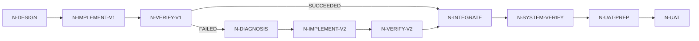

# Canonical Agent DAG Runtime v0.2

状态：Accepted / executable contract

本文件定义长任务 DAG 的机器契约；Go executor 只执行契约，不另造一套业务拓扑。

## 1. Normative artifacts

1. `configs/agent-dag-runtime-v0.2.schema.json`：结构、枚举和必填字段；
2. `internal/dag/manifest.go`：JSON Schema、语义校验、拓扑和 activation；
3. `internal/dag/executor_test.go`：正例、负例、重试、gate、lease 和 crash 证据；
4. `configs/software-feature-with-rework-and-uat.json`：完整 manifest 实例；
5. `internal/dag/executor.go`：状态、attempt、artifact、evidence 和 durable scheduler。

说明：示例 manifest 的 UAC task data 保留了历史 `uv run`/`.py` 文本，以维持既有
`spec_hash` 和回放证据。它们是数据字段，不是 Go runtime 的执行依赖；修改前必须重新计算
manifest hash 并同步事件契约。

## 2. Top-level invariants

### I1 Manifest is the source of truth

一次 run 的 `manifest_id/spec_hash` 固定。用户视图、ready set、进度和报告由 manifest 与事件派生，
不能由模型自由改写。

### I2 Scheduler is the only state committer

LLM、worker 和用户只能提交 proposal/result/decision。只有 executor 调用 `Store.CommitStateEvent`，
并写入 `SCHEDULER` 语义的事件。

### I3 Validate before execute

读取 manifest 后依次做 JSON Schema、节点/边引用检查、拓扑排序和 activation 语义校验，失败时不创建 attempt。

## 3. Node contract

每个 node 至少声明：

- `node_id/title/objective/work_type/executor_role`；
- 输入和输出 `artifact_contracts`；
- `activation.mode`：`ALL`、`ANY` 或 `QUORUM`；
- `gate_policy`：`NONE`、`AGENT`、`USER`、`JOINT`；
- `execution_policy.retry_policy`：最大次数、可重试结果和 fresh attempt；
- `context_policy`：exact constraints、summarize、reference-only、exclude；
- `write_scope`：路径、网络和 secret profile。

Node 输出不是“模型说完成”，而是满足 required output contract 且有 `PASS` evidence 的 result。

## 4. Activation

对每条 gating edge 计算 predicate：

```text
SATISFIED: source state satisfies predicate
WAIT:      source is not terminal and may still satisfy
BLOCKED:   required quorum can no longer be reached
```

`ALL` 要求所有 incoming edge satisfied；`ANY` 至少一条；`QUORUM` 达到阈值。失败分支可以声明
`NODE_STATE == FAILED` edge，把旧 attempt 送入 diagnosis/rework。

## 5. Attempt and lease

执行顺序固定为：

```text
acquire lease
 -> append ATTEMPT_LEASED
 -> append ATTEMPT_STARTED
 -> run with fresh agent/context
 -> release lease
 -> accept artifact/evidence
 -> append NODE_SUCCEEDED / RETRY / FAILED
```

同一 node 的 lease 资源键为 `dag:<manifest_id>:<node_id>`。worker 崩溃后重新加载 checkpoint，
将 `LEASED/RUNNING` attempt 标记 `ABANDONED`，释放 lease，再创建新的 `attempt_id` 和 `agent_instance_id`。

## 6. Artifact and evidence

Artifact 使用内容摘要和 provenance：

```text
artifact_id, contract_id, sha256, media_type,
producer_node_id, producer_attempt_id, input_artifact_ids
```

Evidence 绑定 criterion、artifact、attempt、method、expected/observed 和 verdict。旧失败 artifact 保留，
返工只通过 contract 显式传递，不复制上轮上下文。

## 7. User Acceptance

`USER`/`JOINT` node 在执行前进入 `WAITING_USER`，报告 `waiting_node_id`。恢复需要显式 `PASS/PASSED/APPROVED`；
其他结果进入 `FAILED`。通过后 scheduler 追加 user artifact/evidence，再继续后继节点。

## 8. Example graph



happy path 将 diagnosis/v2 标记为 `BLOCKED`；rework path 保留 V1 两个失败 attempt，使用新 agent 完成 v2。

## 9. Recovery and replay

Harness Store 每次提交同时更新 materialized DAG state、immutable event 和 checkpoint。重放检查：

```text
sequence = 1..n
event[n].previous_hash = event[n-1].event_hash
event_hash = SHA256(canonical event)
```

篡改或缺链直接返回 conflict，不继续调度。

## 10. Verification commands

```bash
jq empty configs/agent-dag-runtime-v0.2.schema.json
jq empty configs/software-feature-with-rework-and-uat.json
go test ./internal/dag -v
go run ./cmd/agent-dag -run dag-demo
go run ./cmd/agent-dag -run dag-rework -rework
```

生产替换项是 PostgreSQL/queue/distributed lease/CAS/sandbox；这些不由本地 deterministic fixture 冒充。
