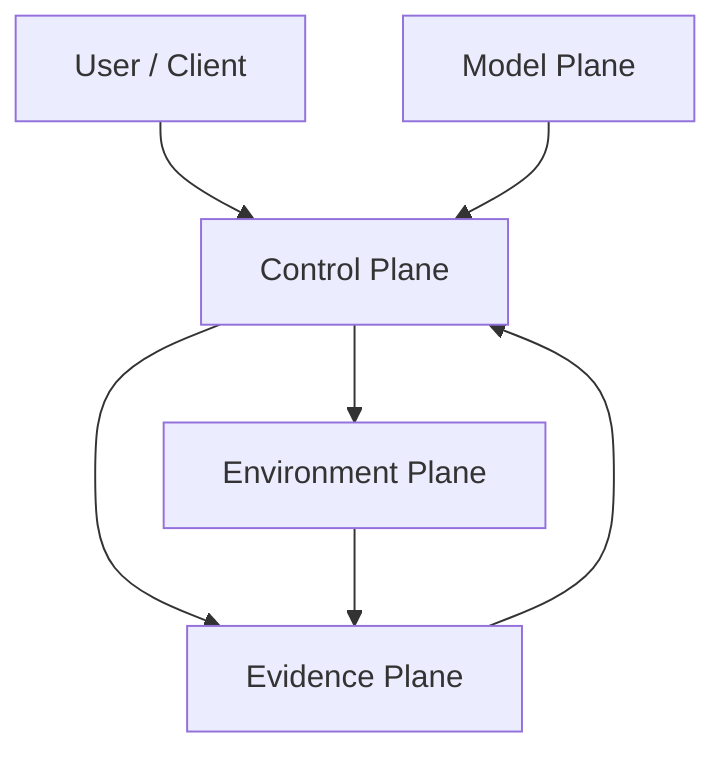

# Agent Harness Runtime Design

状态：Accepted / local executable prototype

## 1. 目标与边界

本项目解决的是长任务 Agent 的控制面问题，而不是训练一个新模型。目标是把一次任务从
模型 proposal 组织成可恢复、可验证、可审计的执行过程：

```text
request -> identity/policy -> context -> model proposal
        -> tool/subagent/user gate -> observation
        -> verifier -> durable state/event/checkpoint -> replay/evaluation
```

当前实现是 Go 单进程、SQLite、确定性 fixture。它证明协议闭环和故障语义；生产部署仍需
替换持久化、队列、分布式租约、沙箱、身份和观测设施。

非目标：伪造 GPU KV tensor、训练模型、宣称线上成功率，或让模型直接写领域状态。

## 2. 四层边界



### Model plane

`ModelAdapter` 只返回 `ModelResponse`：文本、tool call、subagent request 或 user gate。
`ScriptedModel` 用于离线复现，`OpenAICompatibleAdapter` 负责兼容 OpenAI 风格的 complete
和 SSE stream。模型没有 `Store` 或控制面数据库的写权限。

### Control plane

`Runtime` 负责身份绑定、上下文编译、预算、循环检测、工具编排、verifier、gate、取消、
checkpoint 和恢复。只有 runtime/scheduler 可以追加决定性状态事件。

### Environment plane

`ToolRuntime`、MCP envelope 和执行策略是副作用边界。工具声明 JSON
Schema、scope、side effect、timeout、retry 和 idempotency 要求。

### Evidence plane

`Store` 保存 materialized task state、immutable event journal、checkpoint、lease、memory、
idempotency 和 feedback。事件使用 `previous_hash + sequence + type + canonical payload`
形成 SHA-256 链，`Replay` 会检查顺序、链接和重算 hash。

## 3. 核心状态契约

### 3.1 Harness task

```text
READY -> RUNNING -> COMPLETED
                 -> WAITING_USER -> RUNNING
                 -> FAILED / CANCELLED
```

每个 task 绑定 `task_id + tenant_id + subject_id + goal`。同一个 ID 再次提交时只允许继续
同一身份和目标；不允许用相同 task ID 改写另一个租户或目标。

每次继续运行会打开一个 `turn_id`。运行时把 `TURN_STARTED`、`STEP_STARTED`、
`CONTEXT_COMPILED`、`MODEL_REQUESTED`、`MODEL_PROPOSED`、`TOOL_INVOKED`、
`TOOL_OBSERVED`、`STEP_COMPLETED` 和 `TURN_COMPLETED` 写入同一 append-only journal。
`MODEL_REQUESTED` 是完整的 provider-visible projection，因此 session resume 不依赖进程内
的 prompt 缓存；`MODEL_PROPOSED` 只代表模型提议，最终状态仍由 runtime/verifier 提交。

### 3.2 单轮 Agent loop

```text
validate identity
  -> build stable/dynamic context
  -> model complete/stream
  -> charge usage and budget
  -> execute tool / request subagent / open user gate
  -> persist observation
  -> structured output + verifier
  -> memory write + checkpoint
  -> TASK_COMPLETED or deterministic failure
```

运行时限制 `max_steps`、`max_tool_calls`、token/cost budget，并按 tool-call fingerprint
检测重复循环。空输出、schema 不合格或 verifier 不通过不会直接成为完成状态。

## 4. Model API 与可靠性

`ModelRequest` 统一承载：messages、tool schema、response schema、model、
`reasoning_effort`、max output tokens、stream 和 prefix cache key。适配器提供：

- OpenAI-compatible JSON 请求/响应和 tool-call parsing；
- structured output 的标准 JSON Schema 编译与校验（包含 `required`、`enum`、类型和
  `additionalProperties` 等约束）；
- SSE text delta/tool-call delta；
- 429、5xx 等 transient 错误的退避重试；
- `ModelRouter` 的 primary/fallback；
- `CircuitBreaker` 和 `BudgetLedger`；
- provider usage、latency、cost 字段留存。

stream 只改变传输，不改变提交语义。工具参数必须完整、可解析且通过 schema 后才能执行。
客户端断开不会回滚已经提交的副作用。

## 5. Context Engineering、KV 与 Reasoning

`ContextBuilder` 把内容分为：

- stable：系统/开发者规则和稳定协议；
- dynamic：goal、约束、当前 state、observation、用户回应；
- memories、skills、tools：经过租户、scope 和相关性过滤后注入。

`ContextPacket` 是控制面内部的富结构，不直接作为 provider payload。`ProviderMessages`
显式把 state、命中的 memory 和激活的 Skill 投影为标准 `system/developer/user/assistant/tool`
角色消息，把非字符串内容规范化为 canonical JSON 字符串，并移除 `stable` 等本地 cache
标记。observation 只从动态消息投影一次，不在 state envelope 中重复注入。这样既保留模型
实际所需信息，也避免 provider 因自定义 role、非字符串 content 或重复历史而产生协议偏差。

上下文超预算时只压缩叙事消息，`ExactInvariants` 保留原始约束。`PrefixCache` 根据稳定
消息、tool schema、model/revision、reasoning effort、tenant/subject、scope digest、policy
version、compiler version 和激活 Skill digest 计算 key，记录 hit/miss/LRU；这只是 Harness
账务和正确性边界，真实 GPU KV/prompt cache 由 provider 或推理引擎管理。

`reasoning_effort` 是请求变量；可审计信息是 plan、tool decision、verifier reason、failure
category 和摘要，不把隐藏推理当作持久记忆。

## 6. Tools、MCP 与 Policy

工具执行顺序：

```text
lookup spec -> validate JSON schema -> required scope/filter
-> path/tool policy -> idempotency lookup
-> timeout/retry -> classify SUCCEEDED/FAILED/UNKNOWN
-> persist observation
```

带副作用的调用要求 idempotency key；不可逆工具即使没有在 spec 中显式打开该选项也会被
runtime 拒绝无 key 的调用。超时可能已经产生效果，因此状态为 `UNKNOWN`，后续
必须重放相同 key 或进入对账。`ExecutionPolicy` 对工具名、路径、网络和 secret profile
做 allowlist 检查；context compiler 只向模型暴露当前 auth scope 可用的工具 schema，runtime
仍会在真正执行时再次检查。模型 structured output 和工具 arguments 复用同一个标准 JSON
Schema compiler；schema 自身编译失败或实例违反 `enum`、`additionalProperties` 等约束时，
副作用不会开始。

本地 MCP 实现包含 `initialize`、版本协商、`tools/list` 和 `tools/call`，并复用同一
`ToolRuntime`，避免 MCP 绕过 scope、UNKNOWN 和幂等语义。真实 stdio/HTTP/WebSocket transport
属于适配层工作。

## 7. Skills、Memory、Planning 与 Subagent

### Skills

`SkillRegistry` 支持注册、ACTIVE/DEPRECATED 生命周期、版本排序、goal/tag 发现和 scope
过滤。skill 文本不拥有执行权限，工具运行时会再次鉴权。

### Memory

`MemoryManager` 覆盖 working、episodic、semantic、procedural 记录，按 tenant/subject/
namespace 隔离；版本、`supersedes`、过期和 tombstone/forget 防止旧事实重新暴露。

### Planning

`RulePlanner` 为轻量 task 生成结构化 step。长任务使用 `internal/dag` 的 Canonical
Manifest：节点、依赖、ALL/ANY/QUORUM activation、artifact contract、evidence、rework 和
UAT 都是机器契约，不由模型自由修改。

### Subagent / Multi-Agent

`MultiAgentCoordinator` 为每个子任务生成隔离上下文和独立预算，支持并发 fan-out/fan-in。
合并结果保留 artifact/provenance；冲突返回 `CONFLICT`，交给 verifier 或人工决定，不做
无来源的静默多数投票。

## 8. Durable store、lease 与恢复

`CommitStateEvent` 在同一个 SQLite transaction 中检查 version/sequence、追加 hash-chain
事件、更新 materialized state 并写 checkpoint。事件 payload 中的 `_state_digest` 绑定
checkpoint，`ReplayState` 同时验证 journal、checkpoint 和 materialized row。DAG executor 在 node 执行前获取
`dag:<manifest>:<node>` lease，记录 `attempt_id` 和全新的 `agent_instance_id`。

worker 崩溃恢复时：

1. 读取 checkpoint 和事件链并验证；
2. 将 `LEASED/RUNNING` attempt 标记 `ABANDONED`；
3. 释放资源 lease；
4. 创建新的 attempt/context，不复用隐式对话；
5. 根据 artifact/evidence contract 继续、重试、返工或阻断。

失败尝试和证据保留，便于 replay、诊断和评测。

## 9. Evaluation、反馈与自进化边界

`EvaluateCases` 输出 success rate、Wilson 区间、mean steps、p95 latency、mean tool calls
和 failure counts。`RunAblation` 在固定 cases/fixture 上比较 baseline 和候选变量，一次只
改变一个因素。

`FeedbackCollector` 记录 stage、outcome、category、rating、cohort、variant，计算完成、
drop-off、人接管和评分漏斗。产品迭代链路是：

```text
feedback -> failure taxonomy -> hypothesis
         -> fixed-fixture ablation -> guardrailed promotion -> rollback/audit
```

`EvaluatePromotion` 只给出候选配置是否通过样本量、成功率、p95 和 steps guardrail 的决定，
不会自行改写生产代码、领域事实或权限策略。

## 10. Go 代码映射

| 能力 | 实现 | 主要证据 |
|---|---|---|
| 契约、身份、hash | `internal/harness/types.go`、`store.go` | replay/tamper/conflict tests |
| Model API/stream/fallback | `internal/harness/model.go` | adapter/router/stream tests |
| Loop/context/cache | `runtime.go`、`context.go` | provider projection、budget/loop tests |
| Tool/MCP/policy | `tools.go`、`policy.go` | full-schema/scope/UNKNOWN/MCP tests |
| Skills/Memory | `skills.go`、`memory.go` | lifecycle/version/forget tests |
| Planning/DAG | `planning.go`、`internal/dag/` | happy/rework/UAT/crash tests |
| Multi-Agent | `multi_agent.go` | fan-out/conflict test |
| Evaluation/feedback | `evaluation.go`、`experiment.go`、`feedback.go` | CI/ablation/promotion/funnel tests |
| HTTP/SSE | `internal/httpapi/server.go` | end-to-end HTTP test；`Last-Event-ID`、`since`、`follow` |

## 11. 运行与验证

```bash
go run ./cmd/agent-harness -mode demo
go run ./cmd/agent-dag
go test ./...
go test -race ./...
go vet ./...
make build
```

本地 HTTP server：

```bash
HARNESS_DB_PATH=.data/harness.sqlite \
go run ./cmd/agent-harness -mode server -addr 127.0.0.1:8080
```

## 12. 生产替换矩阵

| 当前 fixture | 生产替换方向 |
|---|---|
| SQLite task/event store | PostgreSQL、serializable transaction、备份和灾备 |
| 进程内 lease | 分布式 lease、队列 visibility timeout、renew/DLQ |
| 本地 artifact map | 对象存储/CAS、病毒扫描、retention |
| allowlist policy | OIDC/RBAC、KMS、secret broker、网络隔离 |
| deterministic runner | 进程/容器级 sandbox、资源配额和审计 |
| 手工事件日志 | OpenTelemetry trace/metric/log、PII 脱敏和保留策略 |
| 本地 PrefixCache | provider prompt-cache/KV API 的真实命中证据 |
| fixture evaluation | benchmark、标注指南、judge calibration、灰度/A-B |

以上替换项是后续工程边界，不计入当前原型已经获得的事实。
