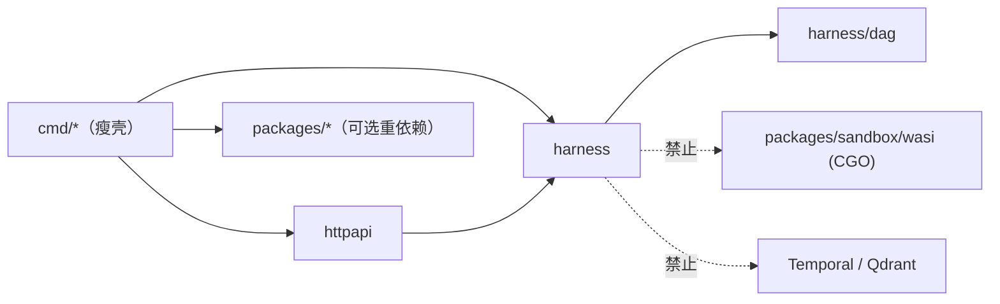

# 可嵌入性改造设计文档

> 目标：让外部 Go 程序能把本项目的控制面**作为库嵌入自己的进程**，而不是只能通过 HTTP 远程调用。
> 状态：**已实施**（P0–P5 全部落地，见下方交付状态）
> 影响范围：`internal/` → 公开包、`httpapi` 反转、构造 API 重写、模块路径变更

---

## 0. 交付状态

本节记录实际实施结果。实现细节见各阶段章节，验证方式见 §9.3 与 §14。

| 验收标准 | 状态 | 证据 |
|---|---|---|
| **C1** 独立 module 可 import 并运行 | ✅ | `examples/embed_external/`（独立 module `example.com/external-consumer`），护栏 G5 |
| **C2** 自定义 Store / Model / Clock 可注入 | ✅ | `examples/embed_custom_store`、`examples/embed_custom_model` |
| **C3** 库包零 `os.Getenv` / 零路径探测 / 零信号处理 | ✅ | 护栏 G3、G4；env 解析集中在 `modelenv` 与 `cmd/` |
| **C4** 核心 CGO-free、无重依赖 | ✅ | 护栏 G1、G2 |

| 阶段 | 状态 | 产出 |
|---|---|---|
| P0 模块路径正名 | ✅ | `github.com/Hanwen-Jiang/dag-code-agent`；`make proto` 重生成无版本漂移 |
| P1 接口抽取 + Option 构造 | ✅ | `harness/store_iface.go`、`journal.go`、`clock.go`、`options.go` |
| P2 提升为公开包 | ✅ | `harness/`、`harness/dag/`、`httpapi/`、`modelenv/`；`internal/` 已删除 |
| P3 cmd 瘦身 + env 出库 | ✅ | `cmd/agent-harness` 成为组装根；模型 env 迁入 `modelenv` |
| P4 证明与护栏 | ✅ | 4 个 example、`harness/storetest` 一致性套件、`scripts/embed-guards.sh`、CI |
| P5 版本与文档 | ✅ | 本文档、README 嵌入章节、CI workflow |

**实施中的两处设计偏差**（均为强化 P1「不变量属于核心」）：

1. `Replay` / `ReplayState` 未按 §6.2 留在后端接口上，而是**上移到核心 `Journal`**。原因：原实现直接查 `harness_checkpoints`
   表，若留在接口上等于要求每个后端重新实现校验逻辑。现改为核心通过 `CheckpointAt` 读取，任何后端都可被校验。
2. `MemoryManager` 原实现直接锁具体结构体的私有 `mu`，这是真实的抽象破坏。改为在 `MemoryStore` 上新增
   `PutMemoryVersioned` 原子原语（与 `AppendEvent` 同构），版本判定留在核心、原子性下沉到后端。

**尚未交付**（不在 C1–C4 验收范围内）：

- §5.4 的执行入口签名变更（`Run` 返回 `(RunResult, error)`）。这是破坏性变更，需在打 tag 前完成，
  否则将变成 major 版本变更。
- §6.3 的 Postgres 后端只做到「编译 + 可用一致性套件验证」，未接 CI 的真实数据库。

---

## 1. 背景

### 1.1 问题陈述

当前项目只能以"服务"形式消费：

```bash
./bin/agent-harness -mode server -addr 127.0.0.1:8080
curl -X POST http://127.0.0.1:8080/api/harness/runs -d '{"goal":"..."}'
```

使用者无法在自己的进程里 `import` 并调用运行时。这意味着：

| 能力 | 服务型 | 嵌入型 |
|---|---|---|
| 注入自定义 Model/Tool/Store | ❌ | ✅ |
| 在用户单测里 mock | ❌（需起 server） | ✅ |
| 传 `context.Context` / 回调 / 流 | ❌（JSON 边界） | ✅ |
| 被其他框架包成节点 | ❌ | ✅ |
| 一进程多隔离实例 | ❌ | ✅ |

### 1.2 "完成"的验收定义

改造完成必须同时满足四条**可机械验证**的标准：

- **C1** 一个**独立 Go module** 能 `import` 公开包并成功编译运行（仓库内 `examples/` 提供证明）
- **C2** 使用者的自定义 `Store` / `Model` / `Clock` 能被注入并生效（有对应 example）
- **C3** 库包（`harness`、`harness/dag`）内**零 `os.Getenv`**、零文件系统路径探测、零信号处理
- **C4** 核心库**不引入 CGO**、不引入 Temporal/Qdrant/wasmtime 依赖

C1–C4 全部由 CI 强制，不靠人工 review。

---

## 2. 现状诊断

诊断基于实测，非文档口径。

### 2.1 阻碍点清单

| # | 阻碍 | 证据 | 严重度 |
|---|---|---|---|
| B1 | 模块路径不可 fetch | `go.mod:1` → `module agent-harness` | **阻断** |
| B2 | 核心在 `internal/` 下，Go 编译器禁止外部 import | `internal/harness/`（6,684 行） | **阻断** |
| B3 | 构造依赖具体类型 | `runtime.go:50` `NewRuntime(store *Store, model ModelAdapter, tools *ToolRuntime, contextBuilder *ContextBuilder, memory *MemoryManager)` | 高 |
| B4 | 存储后端硬编码 SQLite | `store.go:68` `sql.Open("sqlite", path)` | 高 |
| B5 | HTTP 层自己组装一切 | `httpapi/server.go:63` `NewHandler()` 内部读 `HARNESS_DB_PATH` 并 `harness.NewStore()` | 高 |
| B6 | HTTP 层依赖具体 Store | `server.go:21` `HarnessStore *harness.Store` | 高 |
| B7 | DAG manifest 靠 CWD 相对路径探测 | `server.go:96` 四个 `../configs/...` 候选路径 | 高 |
| B8 | 时钟不可注入 | `internal/harness` 内 11 处裸 `time.Now()` | 中 |
| B9 | 环境变量耦合 | `provider.go:77` `NewChatModelFromEnv()`、`DescribeModelProvider()` | 中 |
| B10 | CORS 硬编码 | `server.go:112` `Access-Control-Allow-Origin: *` | 低 |
| B11 | `examples/` 为空目录 | — | 文档负债 |

### 2.2 关键发现：哈希链不变量焊死在存储层

这是**决定接口怎么切**的核心事实：

```go
// internal/harness/store.go:217
func (s *Store) CommitStateEvent(state TaskState, eventType string, payload map[string]any,
                                 expectedVersion, expectedSequence *int) (Event, error) {
    state.Normalize()
    stateJSON, err := encodeState(state)
    payload = eventPayload(state, payload)      // ← 注入 _state_digest
    err = s.withTx(func(tx *sql.Tx) error {
        // ← 读 currentVersion
        // ← 查上一条 event_hash 作为 previous（无则 GENESIS）
        // ← 校验 expectedVersion / expectedSequence（乐观并发）
        // ← 计算 sha256 链、写 harness_events
    })
}
```

**结论**：链的完整性（`_state_digest` 绑定、`previous` 引用、单调 `sequence`）与 SQL 事务逻辑**交织在同一个函数体内**。

如果按常规做法直接抽 `Store interface`，等价于要求每个第三方后端**自己重新实现哈希链**。他们一定会实现错（漏掉 `previous`、用本地时间、忘记 CAS），而项目最核心的卖点"篡改可检测"就此失效。

**因此本设计的第 3 条硬约束是：不变量计算必须上移到核心，存储后端只负责"原子的条件追加"。**

### 2.3 有利因素

| 事实 | 证据 | 影响 |
|---|---|---|
| 导出签名**无 SQL 类型泄漏** | `sql.` 仅出现在 `store.go` 内部 13 处；`withTx` 未导出 | 接口可干净抽取 |
| 无包级可变全局 | 仅有 `ErrContextBudget`、`err` 变量 | 多实例友好 |
| `ModelAdapter` 已是接口 | `model.go` | 模型注入成本低 |
| 已有依赖注入的雏形 | `demo.go:46` `BuildDemoEnvironmentWithStore(store, request, auth)` | 可作设计模板 |
| SQLite 驱动是纯 Go | `modernc.org/sqlite` | 核心可保持 CGO-free |

---

## 3. 设计原则

四条不可谈判的硬约束：

**P1 · 不变量属于核心，后端只做持久化。**
任何"正确性保证"（哈希链、CAS 语义、租约互斥）都必须在 `harness` 包内实现。后端实现错误只能导致性能下降，**不能导致语义失守**。

**P2 · 库不读环境。**
`harness` / `harness/dag` / `httpapi` 内禁止 `os.Getenv`、`os.Stat` 相对路径探测、`signal.Notify`。所有配置显式传参，env 解析只允许出现在 `cmd/`。

**P3 · 公开面窄而稳。**
宁可多几个小接口，不要一个大接口。未承诺稳定的 API 放 `harness/experimental/`。

**P4 · 依赖方向单向。**
`cmd` → `httpapi` → `harness` → `harness/dag`。核心永不反向 import 适配层。

---

## 4. 目标架构

### 4.1 目录结构

```text
dag-code-agent/
├── harness/                    # 【公开】核心运行时（原 internal/harness）
│   ├── runtime.go              #   New(opts...), Runtime
│   ├── options.go              #   【新】Option 模式
│   ├── clock.go                #   【新】Clock 抽象
│   ├── store.go                #   接口定义 + 默认 SQLite 实现（拆分后见 §6）
│   ├── storetest/              #   【新】后端一致性测试套件
│   └── ...
├── harness/dag/                # 【公开】Canonical DAG（原 internal/dag）
├── httpapi/                    # 【公开】HTTP 适配层（薄、可选）
├── cmd/                        # 【瘦壳】只做 env 解析 + 组装 + 启动
├── examples/                   # 【新】可嵌入性证明（见 §10）
│   ├── embed_offline/
│   ├── embed_custom_store/
│   └── embed_custom_model/
└── internal/                   # 仅保留真正不该外露的实现细节
```

`internal/httpapi` 提升为顶层 `httpapi`：使用者也应该能嵌入 HTTP 层（自带鉴权/CORS/路由前缀）。

### 4.2 依赖方向



核心依赖极小化是被 CI 强制的（见 §9）。

---

## 5. 核心 API 设计

### 5.1 构造：Option 模式

废弃 5 个位置参数的具体类型构造，改为：

```go
// harness/runtime.go
type Runtime struct {
    store   Store          // 接口，非 *Store
    model   ModelAdapter
    tools   *ToolRuntime
    ctx     *ContextBuilder
    memory  *MemoryManager
    planner Planner
    verify  VerifyFunc
    budget  *BudgetLedger
    clock   Clock
    logger  *slog.Logger
    tracer  Tracer

    mu       sync.Mutex     // 保持不导出
    loopSeen map[string]map[string]int
}

func New(opts ...Option) (*Runtime, error)
```

使用形态：

```go
rt, err := harness.New(
    harness.WithStore(myStore),          // 省略则默认内存 SQLite
    harness.WithModel(myModel),          // 省略则默认 EchoModel
    harness.WithClock(myClock),
    harness.WithLogger(logger),
)
defer rt.Close()
```

**默认值策略**：零参数 `harness.New()` 必须能成功并可用（内存 SQLite + 离线模型）。这是嵌入的最低门槛——`examples/embed_offline` 就靠它。

`Option` 定义：

```go
type Option func(*config) error
```

返回 `error` 而非静默忽略，便于 `WithStore(nil)` 这类错误尽早暴露。

**同时保留旧构造**一个版本周期（见 §12），标注 `Deprecated`。

### 5.2 时钟注入

```go
// harness/clock.go
type Clock interface{ Now() time.Time }

func SystemClock() Clock                    // 默认
func FixedClock(t time.Time) Clock          // 测试
func SteppedClock(t time.Time, d time.Duration) Clock  // 可推进
```

`internal/harness` 内 11 处 `time.Now()` 全部改为 `r.clock.Now()` / `s.clock.Now()`。租约 TTL、checkpoint 时间戳、idempotency 过期全部走注入时钟。

**收益**：使用者可以写"租约在第 31 秒过期"的确定性测试，而不用 `time.Sleep`。

### 5.3 模型层

`ModelAdapter` 接口保留（已是接口）。要做的两件事：

1. `NewChatModelFromEnv()` / `DescribeModelProvider()` **移出核心**，搬到 `cmd/` 或独立的 `harness/modelenv` 包
2. 核心提供 `EchoModel`（确定性离线模型）作为默认，保证零依赖可跑

### 5.4 执行入口签名（需决策）

实测的真实签名：

```go
// internal/harness/runtime.go:81
func (r *Runtime) Run(ctx context.Context, request TaskRequest, auth AuthContext) RunResult

// runtime.go:27
type RunResult struct {
    TaskID          string
    Status          string             // harness.TaskCompleted / TaskFailed / ...
    State           TaskState
    FinalAnswer     string
    FailureCategory string
    Events          []Event
    Metrics         map[string]float64
}
```

作为**服务端内部实现**这是合理的（业务失败也是"正常返回值"，HTTP 层据此映射状态码）。但作为**公开库 API** 有三个问题：

1. **不符合 Go 惯例**：外部使用者预期 `(T, error)`。`res, err := rt.Run(...)` 是肌肉记忆。
2. **无法区分两类失败**：
   - *基础设施错误*（store 挂了、ctx 取消）——调用者应该重试或向上传播
   - *任务未完成*（模型没给出合格输出）——是正常业务流程
   现在两者都被压平进 `RunResult.Status`，调用者无法区分。
3. **ctx 取消无法传播**：`Run` 吞掉了 `ctx.Err()`，使用者拿不到 `context.Canceled`。

**建议改为**：

```go
// 业务结果仍在返回值里；基础设施错误走 error。
func (r *Runtime) Run(ctx context.Context, req TaskRequest, auth AuthContext) (RunResult, error)
```

判定规则写死为：

| 情况 | 返回 |
|---|---|
| 任务正常完成 / 模型给出不合格输出 | `(res, nil)`，看 `res.Status` |
| `ctx` 取消 / 超时 | `(res, ctx.Err())` |
| Store / 内部错误 | `(res, err)` |

> **兼容性提示**：这是**破坏性变更**。旧签名的两个方法（`Run`、`ContinueRun` 系列）应在 Phase 1 一起改，因为此时还在 `internal/` 内，外部无感知。**错过 Phase 1 再改就要走 major 版本**。

---

## 6. 存储抽象设计

这是改造的核心，也是唯一有真实风险的部分。

### 6.1 不变量上移（P1 的落地）

把 `CommitStateEvent` 拆成"核心算 + 后端存"两段：

```go
// harness/event_chain.go  【核心，不可被替换】
// NextEvent 计算下一条事件：注入 _state_digest、绑定 previous、递增 sequence、算 sha256。
func nextEvent(prev *Event, state TaskState, eventType string, payload map[string]any) (Event, error)

// ReplayState 校验链完整 + 三处 digest 一致（保持现状语义）
func (r *Runtime) ReplayState(taskID string) (TaskState, error)
```

后端**只**实现原子条件追加：

```go
// harness/store.go  【后端需实现的唯一写入原语】
// AppendEvent 必须满足：
//   1. 原子性：(taskID, expectedSequence) 与 (expectedVersion) 校验通过才写入
//   2. 冲突返回 ErrStoreConflict（不重试、不自增）
//   3. 写入内容原样保存，不得修改 event_hash / previous
AppendEvent(state TaskState, expectedVersion, expectedSequence int, next Event) error
```

这样：**任何后端写错都只会 fail，不会静默破坏链**——因为 `next` 是核心算好交给它的，后端没有机会算错。

### 6.2 接口按能力拆分（接口隔离）

实测 `*Store` 有 **23 个导出方法**。单个大接口会强迫后端实现全部能力（只想用任务存储的人也得实现向量记忆）。

拆分为：

```go
type TaskStore interface {
    CreateTaskWithEvent(state TaskState, eventType string, payload map[string]any) (Event, error)
    GetTask(taskID string) (TaskState, int, error)
    ListTasks() ([]TaskState, error)
    AppendEvent(state TaskState, expectedVersion, expectedSequence int, next Event) error
}

type EventStore interface {
    Events(taskID string) ([]Event, error)
    EventsSince(taskID string, sequence int) ([]Event, error)
    Replay(taskID string) ([]Event, error)
    LatestCheckpoint(taskID string) (Checkpoint, error)
}

type IdempotencyStore interface {
    PutIdempotency(scope, key string, value any) (bool, error)   // ok=false 表示已存在
    GetIdempotency(scope, key string, out any) (bool, error)
}

type MemoryStore interface {
    PutMemory(auth AuthContext, record MemoryRecord) error
    MemoryRecords(auth AuthContext, namespace string) ([]MemoryRecord, error)
    TombstoneMemory(auth AuthContext, id string) (bool, error)
}

type LeaseStore interface {
    AcquireLease(resourceKey, ownerID, leaseID string, ttl time.Duration) (bool, error)
    RenewLease(leaseID, ownerID string, ttl time.Duration) (bool, error)
    ReleaseLease(leaseID, ownerID string) (bool, error)
    ReleaseResourceLease(resourceKey, ownerID string) (bool, error)
}

type ArtifactStore interface {
    PutArtifact(auth AuthContext, artifactID string, content map[string]any) (ArtifactRecord, error)
    GetArtifact(auth AuthContext, artifactID string) (ArtifactRecord, bool, error)
}

type FeedbackStore interface {
    PutFeedback(signal FeedbackSignal) error
    Feedback(tenantID string) ([]FeedbackSignal, error)
}
```

组合出全量接口与最小可用接口：

```go
// Store 是全量能力（默认实现提供）
type Store interface {
    TaskStore; EventStore; IdempotencyStore; MemoryStore
    LeaseStore; ArtifactStore; FeedbackStore
    io.Closer
}

// CoreStore 是运行 Runtime 的最小需求（DAG 持久化 + 事件链）
type CoreStore interface {
    TaskStore
    EventStore
    io.Closer
}
```

**Runtime 只依赖 `CoreStore`**。记忆、租约、工件、反馈各自作为可选能力按需声明：

```go
func New(opts ...Option) (*Runtime, error)   // 需要 CoreStore
func WithMemoryStore(m MemoryStore) Option
func WithLeaseStore(l LeaseStore) Option
```

这样"只想嵌入任务编排"的使用者只实现 8 个方法，而不是 23 个。

### 6.3 默认实现保持零依赖

`harness.NewSQLiteStore(path string) (Store, error)` —— 纯 Go 驱动，保留现有行为（`MaxOpenConns(1)`、`busy_timeout=5000`）。

> **需在文档显著标注**：SQLite 实现是**单连接串行**的。同进程内嵌多个 runtime 实例共用一个 DB 文件会互相阻塞。多实例场景应使用内存模式或外部后端。这是嵌入场景最容易踩的坑。

### 6.4 后端一致性套件

新增 `harness/storetest` —— 一套可被第三方后端引用的测试套件：

```go
package storetest

// RunAll 对一个 Store 实现跑全部一致性检查。
func RunAll(t *testing.T, newStore func(t *testing.T) harness.Store)

// 检查项：
//   - 事件链：previous 引用正确、sequence 单调、篡改后 ReplayState 报错
//   - CAS：expectedVersion/expectedSequence 冲突返回 ErrStoreConflict
//   - 幂等：PutIdempotency 第二次返回 ok=false
//   - 租约：Acquire 互斥、TTL 过期后可再获取、Renew 续期、Release 释放
//   - 记忆：命名空间隔离、tenant/subject 隔离、Tombstone 生效
//   - 工件：内容寻址 sha256 稳定、重复写入幂等
//   - Replay 确定性：同一事件流重放出同一 state
```

使用者实现自己的 Postgres 后端后，一行 `storetest.RunAll(t, ...)` 就能自证正确性。**这是"成熟框架"的标志物**：把不变量变成可执行的契约，而不是文档里的承诺。

---

## 7. HTTP 适配层反转

### 7.1 现状问题

```go
func NewHandler() (http.Handler, func(), error) {
    controlPath := os.Getenv("HARNESS_DB_PATH")   // ← 库读 env
    return NewHandlerWithPaths(controlPath)        // ← 内部自建 Store
}
```

HTTP 层既是适配器又是组装根，使用者完全无法注入。

### 7.2 目标形态

```go
// httpapi/httpapi.go
type Config struct {
    Store        harness.CoreStore        // 必填，由调用方注入
    Runtime      *harness.Runtime         // 可选，省略则按 Store 构造
    DAGManifest  dag.Manifest             // 必填，不再做路径探测
    CORSOrigins  []string                 // 默认空 = 不加 CORS 头
    RoutePrefix  string                   // 默认 ""
    Auth         AuthFunc                 // 可选钩子
    Logger       *slog.Logger
}

func New(cfg Config) (http.Handler, error)
```

变化点：

| 项 | 改造前 | 改造后 |
|---|---|---|
| Store 来源 | 内部 `NewStore(env)` | 调用方注入 |
| env 读取 | 库内 | 移除 |
| DAG manifest | 4 个相对路径探测 | 调用方传入 |
| CORS | 硬编码 `*` | 可配置，默认关闭 |
| 类型 | `*harness.Store` | `harness.CoreStore` |

**路径探测搬去 `cmd/`**：

```go
// cmd/agent-harness/main.go —— 组装根，允许读 env / 探测路径
func resolveManifest() (dag.Manifest, error) { /* 原 loadDAGManifest 逻辑 */ }
```

旧 `NewHandler()` / `NewHandlerWithPaths()` 保留为 `Deprecated` 薄包装，一个版本周期后删除。

---

## 8. 生命周期与多实例

### 8.1 要求

- `harness.New()` 不得启动任何 goroutine、不得注册信号处理
- `Runtime.Close() error` 释放资源（幂等）
- `Runtime.Shutdown(ctx) error` 优雅停止（等待在途任务，受 ctx 约束）
- 同进程支持多实例（不同 Store）

### 8.2 验证

```go
func TestMultipleInstancesInOneProcess(t *testing.T) {
    a, _ := harness.New(harness.WithStore(memStoreA))
    b, _ := harness.New(harness.WithStore(memStoreB))
    // 两个 runtime 完全隔离，互不可见对方的 task
}
```

信号处理只保留在 `cmd/*/main.go`。

---

## 9. 依赖卫生与自动化护栏

可嵌入性的隐性杀手是**依赖传染**：使用者 import `harness` 却被迫接受 CGO、Temporal、Qdrant。

### 9.1 规则

核心库（`harness`、`harness/dag`）的传递依赖**必须**满足：

- 无 CGO（`CGO_ENABLED=0` 可构建）
- 不引入 `go.temporal.io/sdk`、`github.com/qdrant/go-client`、`github.com/bytecodealliance/wasmtime-go`、`github.com/jackc/pgx/v5`
- 依赖数量有预算上限（初始建议 ≤ 8 个直接依赖）

### 9.2 实测基线

改造前先跑一遍护栏，结果如下（实测）：

| 护栏 | 现状 | 说明 |
|---|---|---|
| **G1** `CGO_ENABLED=0` 构建核心 | ✅ **已通过** | 核心本就 CGO-free |
| **G2** 核心无重依赖 | ✅ **已通过** | 闭包内无 wasmtime / temporal / qdrant / pgx |
| **G3** 库包不读 env | ❌ **10 处违规** | `provider.go`(6)、`demo.go`(2)、`httpapi/server.go`(2) |
| **G4** 库包无相对路径探测 | ❌ **1 处违规** | `httpapi/server.go:104` |
| **G5** 外部 module 可 import | ❌ **未建立** | 无 example、无独立 module |

核心的依赖实况相当干净：

```
直接第三方依赖（仅 2 个）：
  github.com/santhosh-tekuri/jsonschema/v5     # JSON Schema 校验
  modernc.org/sqlite                            # 纯 Go SQLite 驱动

传递模块闭包（12 个，全部纯 Go）：
  modernc.org/{sqlite,libc,mathutil,memory} + bigfft, go-humanize,
  go-isatty, go-strftime, google/uuid, jsonschema/v5, x/exp, x/sys
```

**结论：C4（CGO-free + 轻依赖）实际上已经满足，不需要额外工作**——这显著降低了改造难度。真正要动手的是 G3/G4 的 11 处 env/路径耦合，以及 §6 的接口工程。

**依赖预算**（防回退）：直接第三方依赖上限 **4 个**（当前 2 个，留 2 个余量）；传递闭包上限 **20 个模块**（当前 12）。

### 9.3 CI 护栏

```bash
# G1: 核心包必须能在禁用 CGO 时构建
CGO_ENABLED=0 go build ./harness/... ./harness/dag/...

# G2: 核心不得依赖重组件
! go list -deps ./harness/... | grep -qE 'wasmtime|temporal|qdrant|pgx'

# G3: 库包禁止读环境
! grep -rn 'os.Getenv\|os\.LookupEnv\|signal\.Notify' harness/ httpapi/ --include='*.go'

# G4: 库包禁止相对路径探测
! grep -rn 'os\.Stat("\.\.' harness/ httpapi/ --include='*.go'

# G5: 外部可 import（消费者契约测试，见 §10.2）
cd examples/embed_external && go build ./...
```

任一条失败即 CI 红。**C1–C4 验收标准由此变成机器执行的检查**。

---

## 10. 可嵌入性证明

### 10.1 `examples/` 必须可运行

```go
// examples/embed_offline/main.go —— 最简嵌入（零配置）
// 注意：Run 的签名是既有 API（见 §5.4），此处按现状书写。
func main() {
    rt, err := harness.New()                 // 内存 SQLite + 离线模型
    if err != nil { log.Fatal(err) }
    defer rt.Close()

    auth := harness.AuthContext{
        TenantID:  "local",
        SubjectID: "dev",
        Scopes:    []string{"memory:read", "artifact:write", "artifact:read"},
    }
    res := rt.Run(context.Background(), harness.TaskRequest{
        Goal: "write an artifact and return verified JSON",
    }, auth)

    if res.Status != harness.TaskCompleted {
        log.Fatalf("run failed: %s (%s)", res.Status, res.FailureCategory)
    }
    fmt.Println(res.FinalAnswer)
}
```

三个 example 覆盖验收标准：

| example | 证明 |
|---|---|
| `embed_offline` | 零配置可用（C1、门槛） |
| `embed_custom_store` | 自定义 Store 可注入（C2、验证接口切分合理） |
| `embed_custom_model` | 自定义 Model + Clock 可注入（C2） |

### 10.2 消费者契约测试

**独立 module** 强制暴露 `internal/` 泄漏问题：

```text
examples/embed_external/
├── go.mod        # module example.com/consumer  +  replace => ../..
└── main.go       # import "github.com/<org>/dag-code-agent/harness"
```

因为它是一个**外部模块**，任何对被误留在 `internal/` 的类型的依赖都会编译失败。这是唯一能可靠防止"改着改着又躲回 internal"的机制。

---

## 11. 分阶段迁移计划

每阶段独立可交付、可回滚。

### Phase 0 · 模块路径正名（阻断项，必须先做）

**做什么**：`module agent-harness` → `module github.com/<org>/dag-code-agent`，全仓库 import 路径重写。

**为什么先做**：C1 的绝对前提。目录名 `dag-code-agent` 与模块名 `agent-harness` 不一致本身就是隐患。

**风险**：触及所有文件，与在途改动冲突。**建议冻结分支后一次性完成。**

**验证**：`go build ./... && go test ./...` 全绿；`go list -m` 显示新路径。

---

### Phase 1 · 接口抽取 + Option 构造（在 internal 内原地做）

**做什么**：拆分 `Store` 接口、引入 `Clock`、实现 `New(opts...)`、`Config` 化 `httpapi`。

**为什么**：此时还在 `internal/`，改动不外泄、无需兼容承诺，可以放心大改。

**风险**：中等。`CommitStateEvent` 拆分会碰到哈希链，必须保证现有测试全过（这是安全网）。

**验证**：现有 151 个测试**全部不改**仍通过 + 新增 `storetest` 套件通过。

---

### Phase 2 · 提升为公开包

**做什么**：`internal/harness` → `harness/`，`internal/dag` → `harness/dag/`，`internal/httpapi` → `httpapi/`。

**为什么**：目录移动本身廉价，但**这是 API 承诺的起点**，所以要等接口稳定后再做。

**风险**：低（机械移动）；但一旦公开就很难收回，需配合 §12 的稳定性策略。

**验证**：`go build ./...`；`go doc` 输出无 `internal` 引用。

---

### Phase 3 · cmd 瘦身 + env 出库

**做什么**：把 env 解析、路径探测、信号处理、`NewChatModelFromEnv()` 全部下沉到 `cmd/` 与新的 `harness/modelenv`；`cmd/*/main.go` 变成"读配置 → 组装 → 启动 → 等信号"。

**验证**：CI 护栏 G3/G4 通过；smoke 脚本仍 PASS:18。

---

### Phase 4 · 证明与护栏

**做什么**：填 `examples/`（3 个）、建 `examples/embed_external` 独立 module、接入 G1–G5 到 CI。

**为什么**：这一步把"可嵌入"从声明变成**回归可检测的属性**。

**验证**：故意在 `harness` 里加一行 `os.Getenv` → CI 必须变红（护栏自测）。

---

### Phase 5 · 版本与文档

**做什么**：打 `v0.1.0` tag、写库使用文档、明确 API 稳定性边界、补 `Deprecated` 标记的删除计划。

---

### 工作量估算

| 阶段 | 内容 | 估算 |
|---|---|---|
| P0 | 模块路径 + 全仓 import 重写 | 0.5 天 |
| P1 | 接口拆分 + Option + Clock | 3–4 天 |
| P2 | 包提升 + 文档注释 | 0.5 天 |
| P3 | cmd 瘦身 + env 出库 | 1–2 天 |
| P4 | examples + 护栏 + CI | 1–2 天 |
| P5 | 版本与文档 | 0.5 天 |
| — | **合计** | **7–10 天** |

P1 是唯一有实质技术风险的部分（哈希链拆分 + 23 方法接口切分 + 租约语义保持）。

---

## 12. API 兼容性策略

公开的第一天就要定规则，否则会不断破坏下游。

- **稳定性分层**
  - `harness`、`harness/dag`：**稳定**。破坏性变更需 major 版本 + 迁移说明
  - `harness/experimental/*`：**不承诺**。可随时改
  - `httpapi`：稳定（HTTP 契约与 Go API 分开承诺）
- **弃用流程**：`Deprecated:` 注释 → 保留**至少一个 minor 版本** → 下个 minor 删除
- **兼容性检查**：CI 加 `apidiff`，对比上一个 tag 的公开 API，破坏性变更直接失败
- **首版保留**：Phase 1 产出的旧构造（`NewRuntime`、`NewHandler`、`NewHandlerWithPaths`）标记 `Deprecated`，在 `v0.2.0` 删除

---

## 13. 风险与开放问题

### 13.1 风险

| 风险 | 影响 | 缓解 |
|---|---|---|
| 接口拆分改变租约/并发语义 | 高 | `storetest` + 现有 151 测试作为回归网；先写测试再拆 |
| 大接口强迫后端实现全部能力 | 中 | §6.2 的能力拆分；Runtime 只依赖 `CoreStore` |
| SQLite 单连接在嵌入多实例下阻塞 | 中 | 文档显著警示 + 默认内存模式；提供 `storetest` 让用户换后端 |
| 模块路径变更与在途分支冲突 | 中 | Phase 0 单独一次性提交、冻结窗口 |
| 公开过早导致 API 锁死 | 中 | Phase 1 在 internal 内充分迭代后再提升 |
| 接口动态派发热点性能回退 | 低 | 加基准测试，跑分回退 >5% 即失败 |

### 13.2 决策记录

1. ~~**模块路径定名**~~ → **已定：`github.com/Hanwen-Jiang/dag-code-agent`**
   （Phase 0 已完成：模块声明、全部 Go import、proto `go_package`、Makefile 均已切换，`make proto` 重生成无版本漂移）
2. **`packages/` 的归宿**：19,340 行的悬空包是"公开可选扩展"还是"内部实现"？
   - 若公开 → 需要有独立的依赖卫生规则（wasmtime 带 CGO，绝不能进核心传递依赖）
   - 建议：**公开但物理隔离**，`packages/*` 各自不 import 核心，使用者按需 import
3. **`Runtime` 字段可见性**：当前 `Store/Model/Tools/...` 均导出（外部可改）。改为 unexported + getter，还是保留导出？
   - 建议：**改为 unexported + 只读 getter**。导出字段无法在变更时保护不变量
4. **是否拆多 module**：单 module 简单；多 module（`harness` 独立 go.mod）能更强约束依赖，但维护成本高
   - 建议：**先单 module**，用 CI 护栏 G2 守住依赖边界；确认需求后再拆
5. ~~**Postgres 后端是否本次交付**~~ → **已定：两个都做**（纯 Go 内存 Store 全量跑一致性套件 + 最小 Postgres 后端编译验证）
   - 内存 Store 通过全量 `storetest`，是对接口抽象最有力的证明

> 第 5 条尤其重要：**只有一个实现的接口抽象等于没有抽象**。如果本次不接受 Postgres 后端的工作量，至少要用 `storetest` 跑一个"文件系统 JSON 后端"作为第二实现，证明接口真的可换。

---

## 14. 与验收标准的对应关系

| 标准 | 由哪个阶段交付 | 由哪个护栏验证 |
|---|---|---|
| C1 外部可 import | P0 + P2 + P4 | G5（独立 module 构建） |
| C2 可注入 Store/Model/Clock | P1 + P4 | `examples/embed_custom_*` |
| C3 库不读环境 | P3 | G3 + G4 |
| C4 核心 CGO-free / 轻依赖 | P2 | G1 + G2 |

---

## 附录 A · 改造前后调用对比

**改造前（只能远程调用）**

```bash
./bin/agent-harness -mode server -addr :8080
curl -X POST :8080/api/harness/runs -d '{"goal":"..."}'
```

**改造后（可嵌入）**

```go
// 使用者在自己的进程里
store, _ := harness.NewSQLiteStore("/var/lib/myapp/agent.db")
rt, _ := harness.New(
    harness.WithStore(store),
    harness.WithModel(myGPTAdapter),
    harness.WithClock(myClock),
)
defer rt.Close()

res := rt.Run(ctx, harness.TaskRequest{Goal: "..."}, auth)
if res.Status != harness.TaskCompleted { /* handle */ }

// 也可挂到自己的 HTTP 路由树下
h, _ := httpapi.New(httpapi.Config{
    Store:       store,
    DAGManifest: myManifest,
    RoutePrefix: "/agent",
    CORSOrigins: []string{"https://myapp.example"},
})
mux.Handle("/agent/", http.StripPrefix("/agent", h))
```

同时 `cmd/agent-harness` 仍可独立运行——**服务形态是嵌入形态的薄壳**，而不是并列的两套。

---

## 附录 B · 一句话总结

这次改造的本质不是"把包名从 `internal` 挪出来"，而是**把正确性保证从存储实现里收回到核心**（§6.1），再用机器强制的护栏（§9）和可执行的契约套件（§6.4）保证它不被后来的实现破坏。

做完之后，"可嵌入"不再是文档里的一句声明，而是一个**一旦破坏就会 CI 变红**的属性。
