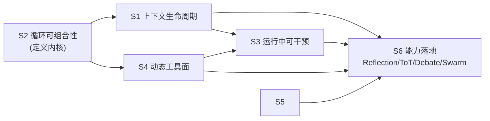

# 框架地基设计文档

> 问题：这份能力大纲（10 个 Part，约 45 项）里，我们的框架**有哪些在真正运行**？没有的那些，需要什么样的**土壤**才能长出来？
> 前置：`docs/embeddability-design.md`（已交付）、`docs/runtime-completion-design.md`（设计完成，待实施）
> 状态：设计完成；S5 协作数据面第一阶段已实施，其余地基和上层策略仍按阶段实施（审计结论基于当前 checkout）。

本文回答两个问题：哪些能力现在已经经过运行时路径验证，哪些能力需要先补“地基”才能以可组合、可重放的方式实现。它是实施边界与验收契约，不是功能已完成的发布说明。

### 0.1 约束与非目标

- `harness` 的事件哈希链、状态 digest、后端一致性套件和可嵌入性 G1–G8 是不可回退的基线。
- 本轮不把 agent-core 变成控制面 loop；它仍是 gRPC 执行/RAG 服务。orchestrator 的接线细节以 `docs/runtime-completion-design.md` §5 为准。
- 本轮不实现 Computer Use 工具族、不引入全局队列或 OpenTelemetry；只定义这些能力依赖的上下文、工具和控制面接口。
- 任何策略都不能直接写 journal、绕过预算或绕过授权；新增事件必须说明 replay 语义。

---

## 1. 审计结果

逐项实测，非推测。判定标准：

- **✅ 有** —— 运行时路径上真的执行，有测试
- **🟡 部分** —— 有实现但不完整，或实现了但未接进运行时路径
- **❌ 无** —— 全仓库 0 命中

### Part 1–2 基础层

| 项 | 判定 | 证据 |
|---|---|---|
| ReAct 循环 | ✅ | `harness/runtime.go` 主循环：`MODEL_REQUESTED` → `MODEL_PROPOSED` → tool → observation → 下一步 |
| 工具调用基础 | ✅ | `ToolRegistry`/`ToolRuntime`：JSON Schema 校验、scope、timeout、重试、幂等、审计 |
| MCP 协议详解 | 🟡 | `harness/tools.go:222` `MCPClient` 直接持本地 `MCPServer`，**无传输层**（自环） |
| Skills 技能系统 | 🟡 | `harness/skills.go`（96 行，词法匹配）；富实现 `packages/skills` 被引用 **0** 次 |
| Hooks 与事件系统 | 🟡 | 事件系统 ✅（journal）；hook 机制 ❌（`packages/hooks` 被引用 **0** 次） |

### Part 3 上下文与记忆

| 项 | 判定 | 证据 |
|---|---|---|
| 上下文工程 | ✅ | `ContextBuilder.Build`：预算、stable 前缀、prefix cache、工具/记忆/技能注入 |
| 记忆架构 | ✅ | `MemoryManager` 版本化 + tombstone + tenant/subject 隔离；但检索是**词法重叠** |
| 多轮对话设计 | ✅ | `UserMessages`、`Resume`、`SendMessage`、`NeedUser` gate |
| 显式 `previous_results` 上下文 | ✅ | `TaskRequest.PreviousResults` → `ContextBuilder` → provider `[previous_results]` 消息；有集成测试 |

### Part 4 单 Agent 模式

| 项 | 判定 | 证据 |
|---|---|---|
| Planning 模式 | 🟡 | `RulePlanner` + `CurrentPlan` + `PLAN_COMPILED` 事件；规划是**规则式**，且规划后不重规划 |
| Reflection 模式 | ❌ | `Reflect`/`critique` **0 命中**。有 `Verifier` 但只在终态校验一次，不是迭代反思 |
| Chain-of-Thought | ❌ | 无显式支持（仅靠提示词自然发生） |

### Part 5 多 Agent 编排

| 项 | 判定 | 证据 |
|---|---|---|
| 编排基础 | 🟡 | `MultiAgentCoordinator.FanOut` 存在，但**从未被运行时调用**（`runtime.go:422` 只记录事件） |
| DAG 工作流 | ✅ | `harness/dag`：canonical manifest、lease、fresh attempt、artifact/evidence、crash recovery、UAT gate |
| Swarm 模式 | ❌ | `Swarm` **0 命中** |
| Handoff 机制 | ❌ | 仅 `feedback.go` 里一个计数字段 `HumanHandoff`，**无机制** |
| Workspace + Topic 共享状态 | 🟡 | 已有 tenant/subject/artifact/lease 原语；新增 Workspace/Topic CAS 存储已接入 SQLite/InMemory，尚未被 DAG/子代理默认使用 |
| Mailbox + protocol | 🟡 | 已有协议校验、顺序投递、幂等键和 ack 的 SQLite/InMemory 实现；尚未接入子代理调度 |

### Part 6 高级推理

| 项 | 判定 | 证据 |
|---|---|---|
| Tree-of-Thoughts | ❌ | `0 命中` |
| Debate 模式 | ❌ | `0 命中` |
| Research-Synthesis | 🟡 | orchestrator 有 `ResearchWorkflow`（plan→execute steps→verify），但走的是 llm-service + 本地降级，**不在控制面内核** |

### Part 7 生产架构

| 项 | 判定 | 证据 |
|---|---|---|
| 三层架构设计 | 🟡 | 三个二进制都在，但 `cmd/orchestrator` 当前没有调用 `proto/agent_core.AgentServiceClient`；`AgentCoreAddr` 只被读取为配置 |
| Temporal 工作流 | ✅ | 真实 SDK v1.49，`ResearchWorkflow`/`CodingWorkflow`/`AnalysisWorkflow` |
| 可观测性 | 🟡 | 自建 trace + XAI 归因；**无 OpenTelemetry**（0 命中） |

### Part 8 企业级特性

| 项 | 判定 | 证据 |
|---|---|---|
| Token 预算控制 | ✅ | `BudgetLedger` + `ContextWindow` + `EstimateTokens` + 超限失败路径 |
| 策略治理 | 🟡 | `ExecutionPolicy`（58 行：工具/路径白名单）；`packages/permissions` 六层引擎被引用 **0** 次 |
| 安全执行 | ✅ | 真实 wasmtime：fuel + epoch 中断、预开目录、内存导出、逃逸测试 |
| 多租户设计 | 🟡 | `AuthContext` 贯穿 memory/artifact 作用域；但**无认证层**（无 token/API key 校验） |

### Part 9 前沿实践

| 项 | 判定 | 证据 |
|---|---|---|
| Deep Research | 🟡 | RAG 管线（`vectordb` + `embedding`）已接 agent-core；无多轮检索-综合循环 |
| Computer Use | ❌ | 无屏幕/输入工具族；`workspace_*` 只有文件操作 |
| Agentic Coding | 🟡 | `workspace_read/search/list/test` + `write_artifact`；**无编辑工具**（无 patch/apply） |
| Background Agents | ❌ | 全仓库无 `Scheduler`/`Queue`/`Background`；且 `run()` 全程持锁，无法后台化 |
| 分层模型策略 | ❌ | `ModelRouter` 是 **Primary/Fallback 故障转移**，不是按难度分层路由 |
| OpenClaw 时代 | — | 课程框架，非功能项 |
| Building on the Harness — Kocoro | — | 课程框架，非功能项 |

### Part 10 Agent Loop 工程

| 项 | 判定 | 证据 |
|---|---|---|
| 从 DAG 到 Agent Loop | 🟡 | **反方向已有**：`HarnessNodeRunner` 让 DAG 节点内跑 harness 循环；但 loop 内部**不能**反向调用 DAG |
| 上下文压缩 | 🟡 | `compressMessages`（`context.go:143`）——见下方专节，这是**截肢不是压缩** |
| Tool Result 预算与外溢 | 🟡 | 仅 `workspace_read` 有局部 `max_bytes`（默认 30k，上限 100k）；**无统一预算、无外溢** |
| 分层压缩 | ❌ | 无分级策略（保留/摘要/外溢/丢弃） |
| Deferred Tool Loading 与 Tool Search | ❌ | `0 命中` |
| Prompt Cache 稳定性 | ✅ | `PrefixCache` + `CompilerVersion` 参与前缀身份 |
| 持久化 Agent Loop | ✅ | 事件哈希链 + checkpoint + `ReplayState` 三处 digest 校验 —— **全项目最强的一块** |
| 运行中操控 Agent | ❌ | `run()` 全程持 `r.mu`（`runtime.go:233`），`SendMessage` 只能**回合之间**生效 |
| Agent 超时与 Watchdog | ❌ | `Watchdog` **0 命中**；只有 ctx 超时 |
| 卡循环检测 | 🟡 | `r.loopSeen` map + 一行 `failAndCommit("LOOP")`；`loopsdetect` 11 种检测器被引用 **0** 次 |
| 并行工具执行 | ❌ | `runtime.go:396` `for _, call := range response.ToolCalls` —— **严格串行** |
| Computer Use 上下文管理 | ❌ | 无（依赖尚不存在的上下文生命周期） |

### 1.1 汇总

| 判定 | 数量 | 占比 |
|---|---|---|
| ✅ 有 | 10 | 22% |
| 🟡 部分 | 17 | 38% |
| ❌ 无 | 16 | 36% |
| — 非功能项 | 2 | 4% |

**关键观察**：🟡 的 17 项里，绝大多数**代码已经写好并在别处通过测试**，只是**没接进运行时路径**（MCP、Skills、Hooks、permissions、loopsdetect、multiagent、agent-core、编排）。这跟前一轮的结论一致——问题不是缺实现，是缺**接线**与**地基**。

---

## 2. 核心论断：能力需要 5 层地基

逐项去补 16 个 ❌ 是错的路径。把能力按「需要什么土壤」重新聚类，得到 5 个共性需求：

| 地基 | 覆盖的能力项 | 现状 |
|---|---|---|
| **S1 上下文生命周期** | 上下文压缩、Tool Result 预算与外溢、分层压缩、Deferred Tool Loading、Computer Use 上下文、Prompt Cache 稳定性、记忆架构、多轮对话 | 只有「每步重新拼装」，**无跨步生命周期**；唯一的压缩是硬截断 |
| **S2 循环可组合性** | ReAct、Planning、Reflection、CoT、ToT、Debate、Swarm、Handoff、Research-Synthesis、从 DAG 到 Agent Loop、分层模型策略 | 循环**硬编码**在 `run()` 里；换拓扑必须改核心代码 |
| **S3 运行中可干预** | 运行中操控、Watchdog、卡循环检测、Background Agents、Hooks、持久化循环的续跑 | `run()` 全程持锁；**无 in-flight 控制通道** |
| **S4 动态工具面与执行调度** | 并行工具执行、Deferred Tool Loading、Tool Search、MCP、Computer Use、Agentic Coding、策略治理 | 工具面是**静态注册 + 每步全量注入 + 串行执行** |
| **S5 协作状态与消息协议** | `previous_results`、Workspace + Topic、Mailbox + protocol、Handoff、Swarm、Debate/ToT 分支汇聚、DAG 数据契约 | 现在只有散落的 `Observations`/DAG artifacts；缺少显式依赖、共享状态 CAS、消息顺序/确认/幂等 |

五个地基之间有依赖：**S1 与 S4 相互需要**（工具结果外溢是上下文技术，延迟加载是工具面技术），**S3 依赖 S2**（没有 step 边界就没有安全的干预点），**S5 依赖 S2 的稳定任务边界和 S1 的上下文投影**。

实施顺序因此是：**S2 最先（它定义内核）→ S1 与 S5 并行 → S4 → S3**。S5 可以先落地存储和协议原语，S4/S3 再把它们接入工具和运行控制。这里的 S1–S5 是本文件的地基编号，不等同于运行时补齐文档的交付阶段编号。

依赖方向也必须保持单向：`harness/dag` 依赖 `harness` 的存储与运行时接口，`harness` 不反向 import `harness/dag`；`httpapi`/`cmd` 位于更外层。需要从 loop 调 DAG 时，通过 `DAGRunner` 接口注入，而不是让核心包直接依赖 DAG 实现。

### 2.1 为什么不是「缺功能」，而是「缺土壤」

用一个反例说明。假设现在要实现 **Reflection 模式**：

- 今天能做的方式：在 `run()` 里加一个 `if reflectEnabled { ... }` 分支。
- 代价：它复制了循环控制流，于是它**必须自己**处理 journal 提交、预算扣减、循环检测、UAT gate、重放一致性——每加一个模式就再复制一遍。加 7 个新增模式 = 7 份并发与持久化代码。

有了 S2 之后的实现：Reflection **只是一个 40 行的装饰器**——「在 Finish 之前插入一次 critique 步」。journal、预算、工具策略、重放全部由内核统一负责。

**这就是「土壤」与「功能」的区别**：土壤让新增能力变成声明式的，而不是让每个能力重新实现一遍基础设施。

---

## 3. 地基 S1：上下文生命周期

### 3.1 现状的准确描述（含一个尖锐问题）

已有的压缩是 `harness/context.go:143`：

```go
func compressMessages(messages []map[string]any, budget int) []map[string]any {
    if len(messages) < 3 { return messages }
    result := []map[string]any{}
    for _, m := range messages {
        role, _ := m["role"].(string)
        if stable, ok := m["stable"].(bool); (ok && stable) || role == "constraint" {
            result = append(result, m)          // 只保留 stable 与 constraint
        }
    }
    tail := messages[len(messages)-1]
    result = append(result, map[string]any{"role": "observation_summary", "content": ...tail...})
    return result                                // 中间全部丢弃
}
```

诚实的评价：

- ✅ 重放一致性**没有**被破坏——它是消息列表的确定性函数，而消息列表在 journal 里，所以 replay 能复现同样的压缩结果。
- ❌ 但它是**截肢**：所有中间轮次（包括工具结果）被丢弃，只留最后一条。这就是多轮对话"接不上上文"的根因。
- ❌ 压缩决策**没有事件**。项目其他每个决策都有事件，唯独"模型看到的上下文被砍掉了什么"只能靠重新推导——与项目自己的证据标准不一致。
- ❌ 无分级：要么全留、要么全丢，没有"摘要替代""外溢保留""按优先级淘汰"。
- ❌ 仍然可能超预算 → 直接 `ErrContextBudget` 让整个任务失败。

### 3.2 设计：四级压缩 + 事件化的决策

```go
// harness/context_plan.go 【新】
type SegmentKind string
const (
    SegmentSystem      SegmentKind = "system"
    SegmentConstraint  SegmentKind = "constraint"
    SegmentSkill       SegmentKind = "skill"
    SegmentMemory      SegmentKind = "memory"
    SegmentToolSchema  SegmentKind = "tool_schema"
    SegmentTurn        SegmentKind = "turn"
    SegmentToolResult  SegmentKind = "tool_result"
    SegmentSummary     SegmentKind = "summary"
    SegmentSpillRef    SegmentKind = "spill_ref"
)

type ContextSegment struct {
    ID       string        // 稳定标识（参与缓存与审计）
    Kind     SegmentKind
    Stable   bool          // 是否属于 prompt cache 的稳定前缀
    Tokens   int
    Priority int           // 淘汰优先级，越大越先被处理
    Content  any
}

// ContextPlan 是一次上下文编译的完整决策记录。必须随 CONTEXT_COMPILED 事件提交，
// 使"模型这一步看到了什么、被砍了什么"可审计、可回放。
type ContextPlan struct {
    Kept       []string
    Summarized []string
    Spilled    []SpillRef
    Dropped    []string
    Tokens     int
    Budget     int
    ProviderMessagesDigest string // 与 MODEL_REQUESTED.model_request 对齐
}
```

**四级流水线**（顺序固定，每级只在前一级不够时才启动）：

| 级 | 动作 | 可逆性 |
|---|---|---|
| 1 | 保留 stable 前缀（system + constraint + skill） | — |
| 2 | **摘要**早期轮次（`Compactor` 策略，默认用便宜模型） | 原文仍在 journal，可回读 |
| 3 | **外溢**大工具结果到 artifact，上下文留 head/tail + 引用 | 可 `Rehydrate` 回读 |
| 4 | 按 `Priority` 淘汰最不重要的片段 | 记录在 `Dropped` |

关键：**第 3 级直接复用已有的 `ArtifactStore`**。它已经是内容寻址、幂等、带 digest、按 tenant/subject 隔离的——外溢所需的一切存储语义都已存在，缺的只是策略调用它。

```go
// harness/spill.go 【新】
type SpillRef struct {
    ArtifactID string
    SHA256     string
    Tokens     int
    Head       string   // 前 N token，直接进上下文
    Tail       string   // 后 N token
}

// SpillStore 把超大片段写入工件存储并返回可回读引用。
type SpillStore interface {
    Spill(ctx context.Context, auth AuthContext, seg ContextSegment) (SpillRef, error)
    Rehydrate(ctx context.Context, auth AuthContext, ref SpillRef) (ContextSegment, error)
}

// Compactor 是有损摘要策略。
type Compactor interface {
    Compact(ctx context.Context, segs []ContextSegment, target int) (ContextSegment, error)
}
```

摘要不是一个可以随时重新调用的副作用。`Compactor` 的输出必须先以 `CONTEXT_COMPACTED` 事件（必要时同时写入 artifact）持久化，再用于本步请求；恢复时优先读取事件中的摘要。若摘要模型失败，必须使用确定性的 head/tail 淘汰并记录 `compaction_fallback=true`，不能因为压缩模型不可用而让整个任务失去可恢复性。

模型看到 `SpillRef` 后可以用**已有的 `read_artifact` 工具**按需取回全文——不需要新工具、不需要新的取回协议。

### 3.3 必须写死的两条规则

**规则一：压缩只能动非稳定后缀。**

这是 S1 与「Prompt Cache 稳定性」的**真实张力**。`PrefixCache` 的命中依赖前缀逐字节稳定；如果压缩重写了早期消息，缓存键就变了，缓存全冷。

因此：**stable 前缀（system + 不可变约束 + skill instructions）在任何压缩下必须逐字节不变**；压缩只作用于其后的 user turn、runtime observation 和 tool_result 片区。运行中追加的用户消息、工具结果和摘要都不能被标成 stable。这条规则让两个特性共存，否则实现者一定会写出“压缩一次、缓存永久失效”的代码。

**规则二：压缩决策必须事件化。**

`CONTEXT_COMPILED` 事件（已存在）扩展为携带 `ContextPlan`。理由与本项目一贯标准一致——**模型可见输入应当可从 journal 重建**。今天的硬截断虽然技术上可重建，但审计者无法直接看出"被砍了什么"，这低于项目在其他环节的标准。

### 3.4 顺带解决的三项

- **Tool Result 预算与外溢** = 第 3 级流水线的直接产物。
- **Deferred Tool Loading** = 把 `SegmentToolSchema` 的优先级调低 + 只注入名称与一行描述（§5.2）。
- **Computer Use 上下文管理** = 截图作为超大 `ContextSegment` 走第 3 级外溢 + 去重（相同截图只留一份引用）。**不需要在循环里特判**。

---

## 4. 地基 S2：循环可组合性

### 4.1 设计：内核固定，拓扑可换

核心原则：**执行归内核，控制流归策略**。

```go
// harness/loop.go 【新】
type ActionKind string
const (
    ActionCallModel  ActionKind = "call_model"
    ActionCallTools  ActionKind = "call_tools"
    ActionSearchTools ActionKind = "search_tools"
    ActionSpawn      ActionKind = "spawn_subagents"
    ActionFanout     ActionKind = "fanout"      // ToT / Debate 的多分支
    ActionVote       ActionKind = "vote"        // Debate 收敛
    ActionHandoff    ActionKind = "handoff"     // Swarm
    ActionRunDAG     ActionKind = "run_dag"     // 反向调用 DAG（Part 10 的"从 DAG 到 Agent Loop"）
    ActionAskUser    ActionKind = "ask_user"
    ActionInterrupt  ActionKind = "interrupt"  // watchdog/strategy 请求在安全点停止
    ActionFinish     ActionKind = "finish"
)

type Action struct {
    Kind      ActionKind
    Model     *ModelRequest
    Tools     []ToolCall
    Search    *ToolSearchSpec
    Subagents []SubagentSpec
    Fanout    *FanoutSpec     // N 个候选 + 打分函数 + 剪枝策略
    Finish    *FinishSpec
}

type ToolSearchSpec struct {
    Intent string
    Limit  int
}

type FanoutSpec struct {
    Branches int
    Scorer   string // 注册表中的确定性 scorer 名称，不接受任意函数序列化
    PruneAfter int
}

type FinishSpec struct {
    Text         string
    Verify       bool
    FailureCode  string
}

type StepResult struct {
    Action      ActionKind
    Model       *ModelResponse
    ToolResults []ToolResult
    Subagents   []SubagentResult
    ErrorCode   string
}

// Strategy 只决定"下一步做什么"，不负责执行。
// 执行（journal 提交、预算扣减、工具策略、重试、重放）由 kernel 统一负责。
type Strategy interface {
    Name() string
    Next(ctx context.Context, st LoopState) (Action, error)
    OnResult(st LoopState, r StepResult) LoopState
}
```

内核保留今天 `run()` 的全部职责（写事件、扣预算、走工具策略、检查 ctx、处理 UAT gate、循环检测），只是把「决定下一步」外包给 `Strategy`。

每个 `ActionKind` 都有唯一的内核执行入口：`call_model` 走模型预算与 `MODEL_*` 事件，`call_tools` 走 `Authorizer`/`HookBus`/`ToolBatch`，`search_tools` 只更新本步可用工具并提交 `TOOLS_DISCOVERED`，`spawn_subagents` 走 §4 的持久子任务，`run_dag` 走 canonical DAG，`ask_user` 打开既有 user gate，`finish` 才能提交终态。未知 `ActionKind` 必须以 `STRATEGY_ACTION_REJECTED` 记录并让任务失败，不能由策略注入任意事件类型。

### 4.2 八个内建模式 = 八个薄策略

| 模式 | 实现方式 | 估计规模 |
|---|---|---|
| ReAct | 现有 `run()` 逻辑搬进 `ReActStrategy`（**默认**） | 原样迁移 |
| Plan-Execute | `Next` 先产 plan，再逐步执行 | ~80 行 |
| **Reflection** | `Compose(ReAct, WithReflection(rounds))`，Finish 前插 critique | ~40 行 |
| **CoT** | `WithCoT()`：在 CallModel 前注入 think 指令并保留思考段为 stable=false | ~20 行 |
| **ToT** | `Fanout{N, scorer}` + 剪枝 + 递归 | ~120 行 |
| **Debate** | `Fanout{personas}` + N 轮 + `Vote` | ~100 行 |
| **Swarm / Handoff** | `Handoff{byCapability}`：按 `packages/multiagent` 的 fit score **把子目标派给最合适的子代理，结果回到父任务** | ~90 行 |
| Research-Synthesis | 现 orchestrator 流程用内核重写 | ~100 行 |

**Handoff 语义已定（决策 5）：子代理返回结果给父，不做控制权转移。**

这意味着：

- 父任务**始终**持有 task 所有权与 journal 写入权；子代理是**子任务**（`parentTaskID + ":" + agentID`），有自己的 journal，结果以 `SUBAGENT_COMPLETED` 回到父任务；
- **不需要** task 所有权转移、不需要跨任务的状态迁移、不需要"当前 agent"这一可变全局；
- 因此 Swarm 与 §"子代理真实执行"（`runtime-completion-design.md` §4）**是同一套机制**，Swarm 只是"派给谁"的策略差异（按 fit score 选人），而不是另一套执行模型。

> 若将来确实需要「另一个 agent 接管整个任务」，那是在此之上叠加的能力（父任务显式 `Finish` 并把未完成目标交给新任务），而不是修改 Handoff 的语义。这样今天的实现不会被将来的需求推翻。

**关键不变量**：所有策略发布**同一套事件词汇**（`STEP_STARTED` / `MODEL_REQUESTED` / `MODEL_PROPOSED` / `TOOL_*` / `SUBAGENT_*` / `STEP_COMPLETED` / `TASK_COMPLETED` / `TASK_FAILED`）。

这条不变量是整个设计成立的前提：只要事件词汇不变，**replay、UAT gate、DAG 节点、XAI 归因无需任何改动就能支持任何拓扑**。新拓扑若需要新事件，必须是**附加且重放中性**的（不影响既有事件序列的语义）。

策略身份与版本必须在任务首次接受时写入 `TASK_ACCEPTED`；`TURN_STARTED` 只重复引用该身份。恢复任务时按 journal 中的身份查找注册表，找不到精确版本就返回 `STRATEGY_VERSION_UNAVAILABLE`，不能偷偷用当前版本代替。

### 4.3 与 DAG 的双向关系

今天只有单向：DAG 节点内可以跑 harness 循环（`HarnessNodeRunner` 已存在）。

补上反向：`ActionRunDAG` 让循环可以把一个子目标交给 canonical DAG 执行（长任务、需要 lease/UAT 的场景）。这样「从 DAG 到 Agent Loop」与「从 Agent Loop 到 DAG」两条路都通，选择权交给策略而不是架构。该动作必须携带 `run_id`、manifest/spec hash 和幂等键；DAG 结果只通过 `DAG_COMPLETED`/`DAG_FAILED` 事件回到 loop，不能直接改父任务状态。

### 4.4 分层模型策略
`ModelRouter` 今天是 **Primary/Fallback 故障转移**，不要往里塞分层逻辑（两种语义混在一个类型里会互相污染）。新增独立概念：

```go
// harness/loop/modeltier.go 【新】
type TierPolicy struct {
    Classify  ModelTier   // 分类/压缩/摘要 → 便宜模型
    Plan      ModelTier   // 规划 → 强模型
    Execute   ModelTier   // 常规执行 → 中档
    Escalate  ModelTier   // 连续失败后升级 → 强模型
    EscalateAfterFailures int
}
```
按 `Action.Kind` 选层，并把实际使用的层写进 `MODEL_REQUESTED` 事件（可审计：这一步用了哪个模型、为什么）。

### 4.5 自定义策略注册（平台契约）

**决策 2 已定：允许用户实现并注册自定义策略。** 这是「Building on the Harness」能否成立的判据——**能挂自定义策略，才叫平台**。

但"允许注册"如果只提供一个接口，结果是灾难：用户策略一旦不确定，整个 journal 的重放保证就被摧毁。所以注册必须附带**可执行的契约**。

#### 4.5.1 注册面

```go
// harness/loop.go 【新】
// Strategy 决定"下一步做什么"，不负责执行。
type Strategy interface {
    Name() string
    // Version 参与重放身份。策略语义变化时必须递增，否则旧任务会按新语义重放。
    Version() string
    Next(ctx context.Context, st LoopState) (Action, error)
    OnResult(st LoopState, r StepResult) LoopState
}

// 注册与选择
func (r *Runtime) RegisterStrategy(name string, s Strategy) error
func WithStrategy(name string) Option                     // 本次运行使用哪个策略
func WithStrategyRegistry(reg *StrategyRegistry) Option    // 预置一批策略
func (r *Runtime) Strategies() []StrategyInfo              // 内省：名字 + 版本
```

#### 4.5.2 `LoopState`：只读快照，而非可变状态

```go
// harness/loop.go
// LoopState 是内核暴露给策略的只读快照。刻意不是 *TaskState——
// 策略不能改状态，只能决定下一步动作。这样"策略无法破坏不变量"
// 是类型系统保证的，而不是靠文档约定。
type LoopState struct {
    TaskID   string
    Goal     string
    Step     int
    Turns    int
    Plan     []string
    Budget   BudgetSnapshot       // 只读视图
    LastText string
    LastTool []ToolResult
    LastSubs []SubagentResult
    Scratch  map[string]any       // 深拷贝快照；策略私有状态，随 checkpoint 一起持久化
    Clock    Clock                // 唯一允许的时间来源
    RandomSeed uint64              // 种子入库；策略按步派生本地随机源
}
```

运行时还需要把标识生成从包级 `NewID` 抽出来：

```go
type IDSource interface { New(prefix string) string }
func WithIDSource(ids IDSource) Option
```

生产默认实现使用密码学随机数；测试实现按调用顺序返回固定值。事件 payload、子任务 ID、turn ID 和幂等键中凡是会影响状态 digest 的标识，都必须来自这一个 source。

`Scratch` 与 `Clock`/`RNG` 是三个关键设计点：

- **`Scratch`**：策略需要跨步记忆（ToT 的候选池、Debate 的轮次计数）。它必须随 checkpoint 持久化，否则崩溃恢复后策略状态丢失——而策略状态丢失会导致重放轨迹偏移。内核向策略传入深拷贝，策略返回的新快照在提交 checkpoint 前做 schema/大小校验。
- **`Clock`**：策略**禁止**调用 `time.Now()`。需要时间（如"多久没进展"）只能读这里。
- **`RandomSeed`**：策略**禁止**调用全局 `rand`。种子入库，按 `(task_id, step, seed)` 派生本地随机源；重放时使用同一派生规则。

#### 4.5.3 四条契约（写入接口文档与 looptest）

| # | 契约 | 违反后果 |
|---|---|---|
| **R1** | **事件词汇不变量**：策略只能通过 `Action` 表达意图，**不得**直接写 journal；所有事件由内核提交 | 绕过预算/工具策略/审计 |
| **R2** | **确定性**：`Next`/`OnResult` 必须是 `(LoopState, StepResult)` 的纯函数；禁止 `time.Now()`、全局 `rand`、网络、文件系统。权威事件 payload 不得写入墙上时间、随机 ID 或本地延迟；ID 与 Clock 必须由内核注入 | **replay 轨迹偏移，核心资产失效** |
| **R3** | **有界性**：一次 `Next` 只产出一个 `Action`；不得内部循环 | 内核的 `MaxSteps` 失效，任务无法终止 |
| **R4** | **预算与策略不可绕过**：工具调用只能通过 `ActionCallTools` 提出，由内核走 `Authorizer`/`HookBus`/预算 | 策略成为提权通道 |

#### 4.5.4 策略身份入库（重放安全的关键）

策略名+版本必须随 `TASK_ACCEPTED`（或 `TURN_STARTED`）一并提交；重放时使用**记录下来的**版本，而不是当前注册表里的版本。

这与 `ContextBuilder.CompilerVersion` 参与前缀缓存身份**是同一个模式**——项目里已有先例，直接复用其思路：

```go
// 事件载荷扩展
"strategy": {"name": "reflection", "version": "1.2.0"}
```

没有这一条，用户升级策略后，**所有历史任务的重放都会用新语义跑旧轨迹**——这是静默的数据完整性问题，比崩溃更糟。

#### 4.5.5 可执行契约：`harness/looptest`（已交付）

> **交付状态**：§4.5 全部落地（提交 `604f752`、`192a9e4`、本提交）。
> 内核实现在 `harness/loop_kernel.go`，`continueRun` 已改为「策略决策 → 内核执行」。
>
> **实施中发现的两处设计修正**（原设计稿有误）：
>
> 1. **确定性检查需要可注入的 ID 源**。原稿承诺「跑两次 → journal 逐字节相同」，但 `NewID` 用的是
>    `crypto/rand`，`TURN_STARTED` 的 `turn_id` 每次都不同，逐字节相同**不可能达成**。因此新增
>    `WithIDSource`（默认仍为 crypto 随机）；测试注入计数器实现，确定性检查才真正成立。
>    **没有这一步，那条断言只能是空转的。**
> 2. **身份拒绝只对「可续跑」任务成立**。任务已 COMPLETED/FAILED/CANCELLED 时 `Resume` 会短路返回
>    记录结果、**根本不再咨询策略**，因此不存在重放风险，也无从拒绝。一致性套件因此断言
>    「身份被记录 + 升级后历史仍可验证」，并**仅在任务可续跑时**断言拒绝；门控场景的拒绝由
>    `harness/loop_vocabulary_test.go` 专项覆盖（那里能确定性地构造出停在 user gate 的任务）。
>
> **另一处必须写死的保真约束**（内核化时踩到）：工具执行**必须留在模型 step 内**。若把
> 「执行模型刚提出的工具」拆成独立 step，会多出一个 `STEP_STARTED`，而每个 `STEP_COMPLETED`
> 内嵌其所物化状态的 digest —— 于是**之后每个事件哈希都变**。同理，终态分支（gate/finish）
> 必须自己提交 `STEP_COMPLETED`，且在该分支的状态变更**之后**提交。
> `TestReActEventVocabularyAndOrdering` 断言一次脚本化工具调用的**精确 18 事件序列**，就是这条的守卫。


对照 `harness/storetest` 的成熟做法，自定义策略必须能自证：

```go
// harness/looptest/looptest.go 【新】
// RunStrategyConformance 对一个 Strategy 实现跑全部一致性检查。
func RunStrategyConformance(t *testing.T, newStrategy func() harness.Strategy)
```

检查项：

已交付 8 项检查（`RunStrategyConformance`，对内置与自定义拓扑各跑一遍，共 16 项子测试）：

| 检查 | 断言 |
|---|---|
| `Vocabulary` | 运行中不产生未知事件类型 |
| **`Determinism`** | 同一脚本模型跑两次 → journal **逐字节相同**（type + payload + `event_hash`） |
| `Bounded` | 模型永不给终答时，仍必在 `MaxSteps` 内终止 |
| `JournalIntegrity` | `ReplayState` 通过；任务 id 不变 |
| `IdentityIsRecordedAndPinned` | `TURN_STARTED` 记录 `{name, version}`；升级后旧 journal 仍验证；**可续跑时**换版本续跑被拒 |
| `ScratchSurvivesResume` | 续跑后策略私有状态可继续观察 |
| `ToolPolicyIsNotBypassed` | 未注册工具被拒并记为 observation，运行仍收敛到终态 |
| `BudgetCannotHang` | 预算耗尽必须终止，不得 panic 或死循环 |

第 2 项与第 7 项是这套机制的价值所在：它们把"自定义策略不会破坏重放"从承诺变成**用户自己就能跑的测试**。

#### 4.5.6 分级与稳定性

自定义策略接口一旦公开就难以收回。据此分级：

- `Strategy`、`LoopState`、`Action`：**稳定**（v1.0 后破坏性变更需 major）；
- `Action` 的 `Kind` 为新拓扑预留扩展位，但**新增 Kind 是附加变更**，不破坏既有策略；
- 内建七个策略（§4.2）实现同一接口，因此它们既是可用能力，也是**参考实现**——这是"如何写自定义策略"最好的文档。

---

## 5. 地基 S3：运行中可干预

### 5.1 结构性阻碍（必须先解决）

```go
// harness/runtime.go:233
r.mu.Lock()
defer r.mu.Unlock()          // ← 整个 run 期间持锁
```

后果：`SendMessage`、`SetModel` 在运行期间**全部阻塞**；不存在"运行中注入一条消息"的可能。**这是 steering 的真正阻碍，不是缺 API。**

**改造**：把全局 `r.mu` 拆成
1. `r.mu` 只保护可变配置（model/verifier）与实例注册表，**临界区缩到微秒级**；
2. 每个 task 一把锁（`map[taskID]*sync.Mutex` + 注册表锁），串行化同一 task 的并发运行；
3. 运行中的控制走**通道**，不走锁。

这是一个有真实并发风险的改动，必须有 `-race` 覆盖「边跑边注入」的用例。

### 5.2 控制通道

```go
// harness/control.go 【新】
type ControlKind string
const (
    ControlSteer     ControlKind = "steer"       // 注入消息，下一步生效
    ControlInterrupt ControlKind = "interrupt"   // 当前步后停止
    ControlPause     ControlKind = "pause"       // 停在安全点等 resume
    ControlCancel    ControlKind = "cancel"
    ControlSetBudget ControlKind = "set_budget"
)

type Control struct {
    Kind   ControlKind
    Text   string
    Actor  string
    Budget *BudgetConfig
}

type RunHandle struct {
    TaskID string
    ctrl   chan Control
    done   chan struct{}
}
func (h *RunHandle) Steer(text, actor string) error
func (h *RunHandle) Interrupt(reason string) error
func (h *RunHandle) Pause() error
func (h *RunHandle) Done() <-chan struct{}
func (h *RunHandle) Wait(ctx context.Context) (RunResult, error)

// RunAsync 立刻返回句柄；wait 取回结果。这让 Background Agents 成为可能
// （调用方不必阻塞等待），也让 HTTP 层可以真正实现"发送消息给正在运行的任务"。
func (r *Runtime) RunAsync(ctx context.Context, req TaskRequest, auth AuthContext) (*RunHandle, func() (RunResult, error), error)
```

控制通道是有界队列。`Steer`/`Pause`/`Interrupt` 只负责把请求放入队列，返回值表示“已接收”而非“已应用”；队列满或任务已终态时返回可判定错误。运行 goroutine 在检查点取出控制请求、按提交顺序写入 `CONTROL_REQUESTED` 与 `CONTROL_APPLIED`（或 `CONTROL_REJECTED`），然后才改变 loop 输入。这样 replay 读取的是已经持久化的控制结果，不会在回放期间重新执行宿主回调。

**循环内的三个检查点**（缺一不可）：

1. 步进边界（`STEP_STARTED` 之前）
2. 工具批次之前
3. 工具批次之后

**每一条控制动作都必须提交事件**（`CONTROL_REQUESTED` + `STEER_APPLIED` / `INTERRUPT_REQUESTED` / `PAUSED` / `BUDGET_ADJUSTED` / `CONTROL_REJECTED`）。

这是设计的硬约束：控制动作进入 journal 之后，**重放使用同一条已记录的干预结果**，因此“边跑边改”不会破坏重放确定性。如果控制不入库，重放出来的轨迹会与原始运行不同——那会直接摧毁项目最核心的资产。

### 5.3 Watchdog 与卡循环

```go
// harness/watchdog.go 【新】
type Watchdog struct {
    NoProgressTimeout time.Duration   // 多久没有新事件算停滞
    MaxWallClock      time.Duration
    MaxStepsWithoutTool int
    OnStall           func(*RunHandle, StallReport)
}
```

- 停滞判定基于**事件序号是否增长**（而不是时间戳猜测），这是 journal 天然提供的能力；`NoProgressTimeout` 的计时由注入的 `Clock` 或宿主 watchdog 提供，不能在核心里直接读取墙上时间；
- 动作复用已有零件：`ActionInterrupt`（§5.2）+ `loopsdetect` 的 `ForceStop`（接入见 §6.3）；
- **卡循环检测**由 S3 的干预点 + loopsdetect 的 `Nudge` 组成：先警告模型调整策略，连续 3 次才强停。今天的行为是**直接杀任务**，没有任何挽回机会。Watchdog 只提出控制请求，终止事件仍由运行 goroutine 提交。

### 5.4 Background Agents 与「库不启动 goroutine」的约束

可嵌入性设计 §8.1 的约束是：库不能在构造或普通同步 API 中自行启动后台 worker。显式调用 `RunAsync` 是宿主明确选择异步执行的例外；它只为这一次运行创建受控 goroutine，不创建永久 worker、不注册信号，也不负责全局调度。因此后台执行这样设计：

- 库提供 `RunAsync`（显式调用才起 goroutine）与 `ResumePending(ctx)`（扫描非终态任务并续跑）；`ResumePending` 只执行一次扫描，worker 循环由宿主负责；
- **宿主**（`cmd/*`）负责 worker 循环与调度；
- 后台任务的可恢复性由 journal 保证——重启后 `ResumePending` 能从任一非终态任务继续。

这样后台能力成立，同时不破坏嵌入者的进程预期。`CoreStore` 没有 `LeaseStore` 能力时，工具批次不能假设存在资源租约；Runtime 应通过显式 `WithLeaseStore` 注入可选能力，缺失时对可能有副作用的调用强制串行。

---

## 6. 地基 S4：动态工具面与执行调度

### 6.1 并行工具执行

现状严格串行（`runtime.go:396`）。改造要点——**并行必须不破坏重放**：

```go
// harness/toolbatch.go 【新】
type ToolBatch struct {
    Calls       []ToolCall
    MaxParallel int
}

// 并发安全判定：
//   1. ToolSpec.ConcurrencySafe 显式声明（优先）
//   2. 未声明时一律串行；不能从 UNKNOWN 推断为只读
//   3. 同 ResourceKey 的调用串行（复用 LeaseStore 做互斥）
```

为支持这条规则，`ToolSpec` 增加 `ConcurrencySafe bool` 与 `ResourceKey func(map[string]any) string`。`ResourceKey` 只读取已校验的参数；返回空值表示该调用占用工具级互斥锁。未知副作用、未知资源或没有 `LeaseStore` 时选择串行路径，不能为了吞吐量默认并行。

三个关键设计点：

1. **结果按确定顺序提交**。并发完成顺序不确定，但事件与 observation **必须按 `call_id` 排序后写入**，否则同样的输入会产出不同的 journal → 重放不一致。
2. **同资源互斥复用 `LeaseStore`**：两个写同一路径的工具调用必须串行。lease 已经是后端无关的（SQLite/内存/Postgres 都通过一致性套件），直接可用；拿不到 lease 时返回可重试的 `RESOURCE_BUSY`，不能在没有互斥证明时继续执行。
3. **事件序列**：`TOOL_BATCH_STARTED` → 每个调用的 `TOOL_CALL_REQUESTED`/`TOOL_CALL_COMPLETED` → `TOOL_BATCH_COMPLETED`。批次事件让"这一步并发跑了几个工具"可审计。

### 6.2 Deferred Tool Loading 与 Tool Search

工具 schema 目前**全量进 prompt**。在 MCP 生态下（几十上百个工具）这会吃光预算。设计：

```go
// harness/toolcatalog.go 【新】
type LoadLevel string
const (
    LoadEager LoadLevel = "eager"   // schema 常驻 prompt
    LoadLazy  LoadLevel = "lazy"    // prompt 只给名称 + 一行描述
)

// ToolCatalog 是工具面的索引，支持按意图检索。
type ToolCatalog interface {
    All() []ToolDescriptor
    Search(ctx context.Context, intent string, k int) ([]ToolDescriptor, error)
    Load(ctx context.Context, name string) (ToolSpec, error)
}
```

- 默认：核心内置的少数工具 `eager`，外部来源（MCP）`lazy`；
- 模型需要某个 lazy 工具时产出 `ActionSearchTools`，内核检索 → 载入 schema → 提交 `TOOLS_DISCOVERED` → 下一步可用；工具在未加载 schema 前调用必须返回 `TOOL_NOT_LOADED`；
- 检索复用 S1 已经引入的 `Retriever` 接缝（同一套检索抽象，不需要第二套）。

### 6.3 策略治理与安全执行

这块**已有较厚的地基**（`ExecutionPolicy` + WASI + 审批 gate），缺口是**覆盖面**：

- 新工具族（MCP、computer use）必须全部经过同一个 `Authorizer`（设计见 `runtime-completion-design.md` §7.2）；
- `packages/permissions` 的六层引擎（含审计与审批）通过适配器接入——它已经写好，只差接线；
- `packages/hooks` 的四个事件点（PreToolUse/PostToolUse/SessionStart/Stop）直接映射到 S3 的检查点与工具批次钩子。

---

## 7. 地基 S5：协作状态与消息协议

S5 是多 Agent 能力的公共数据面。它解决三个不同问题，不能继续把它们都塞进 `TaskState.Observations`：

| 需要 | 语义 | 权威存储 |
|---|---|---|
| `previous_results` | 当前任务明确依赖哪些已完成结果 | `TaskRequest`/`TaskState` + `CONTEXT_COMPILED` |
| `Workspace + Topic` | 多个任务/Agent 共享可版本化状态 | `WorkspaceStore` + Topic CAS |
| `Mailbox + protocol` | Agent 之间有序、幂等、可确认的消息 | `MailboxStore` + `MailboxProtocol` |

### 7.1 `previous_results`：依赖注入必须是显式输入

`previous_results` 不是普通 metadata，也不是模型自己从历史文本猜出的“上下文”。每项结果至少包含 `result_id`、`source_id`、`kind`、`summary`、`digest` 和可选结构化 `value`。`ContextBuilder` 将其投影为 `[previous_results]` provider 消息，并把它计入上下文预算。

规则：

1. 结果必须来自已完成的步骤/任务，生产者在合并前写入 digest。
2. 同一个 `result_id` 在一次任务中只能绑定一个 digest；冲突是 `DEPENDENCY_CONFLICT`，不能静默覆盖。
3. `previous_results` 是只读输入；需要共享可变状态时使用 Topic CAS，不能修改父任务历史结果。
4. 重放只读取 journal 中记录的结果身份和 digest，不重新查询外部 Agent。

### 7.2 `Workspace + Topic`：共享状态而非共享内存

Workspace 按 `(tenant_id, subject_id, workspace_id)` 隔离。Topic 是命名空间，Topic key 使用 compare-and-swap 版本更新：`expected_version=0` 表示首次写入，冲突返回 `ok=false`。这使并行 Agent 可以共享“当前计划、候选答案、证据索引”等状态，同时保留最后写入者之外的冲突证据。

最小接口已经落地在 `harness/collaboration.go`：`EnsureWorkspace`、`PutTopicValue`、`TopicValues`。SQLite 和 InMemory 后端都通过 `TestCollaborationStore*` 覆盖创建幂等、CAS 冲突、排序和租户隔离。

禁止事项：

- 不把 Workspace 变成跨租户全局缓存。
- 不用 Topic 更新绕过任务 journal；重要决策仍需由父任务提交事件引用 Topic digest。
- 不用“最后写入胜出”掩盖冲突；冲突由策略决定重试、投票或人工 gate。

### 7.3 `Mailbox + protocol`：消息必须可重试、可确认

Mailbox 只负责传输语义，协议负责 envelope 校验。当前 `json/v1` 协议要求 `message_type` 和结构化 payload；后续 Debate、Handoff、DAG result 可以注册更具体的协议版本。

消息语义固定为：

```text
Send(message, idempotency_key)
  -> store assigns per-topic sequence
Receive(workspace, topic, recipient)
  -> ordered, unacked messages (direct + broadcast)
Ack(message_id, recipient)
  -> idempotent acknowledgement
```

消息至少带 `message_id`、`from_agent`、`to_agent`、`protocol`、`message_type`、`correlation_id`、`idempotency_key` 和 payload。发送重试返回原消息，不产生第二个序号；接收不等于确认，只有 Ack 后才从未确认视图消失。

### 7.4 S5 如何支撑上层模式

| 上层能力 | S5 用法 |
|---|---|
| Handoff | 父任务向目标 Agent 的 mailbox 发送 `handoff.request`，结果以 `handoff.result` 回传；父任务仍持有 journal |
| Swarm | `multiagent` 负责选择 Agent，Workspace Topic 保存共享摘要，Mailbox 传递局部任务 |
| Debate | 每个分支写入独立 Topic key，Mailbox 广播 `debate.argument`，Vote 只读取带 digest 的结果 |
| Tree-of-Thoughts | 分支候选写入 `tot/candidates/*`，剪枝通过 CAS 标记状态，不删除原始候选 |
| DAG ↔ Agent Loop | DAG artifact 转成 `previous_results`；loop 请求 DAG 时通过 correlation ID 关联结果 |

S5 的验收不是“能发消息”这么简单，必须验证：两后端行为一致、重试不重复、跨租户不可见、CAS 冲突可观察、消息顺序稳定、Ack 后可恢复。

---

## 8. 已有但被低估的地基（不要重建）

这份审计最有价值的结论之一：**最难的部分已经做完了。**

| 已有资产 | 它其实是哪些能力的地基 |
|---|---|
| 事件哈希链 + checkpoint + `ReplayState` | S3 的**全部可审计性**（干预入库才能重放）、S1 的压缩诚实性、S4/S5 的并行确定性与消息恢复 |
| `ArtifactStore`（内容寻址、幂等、隔离） | S1 的**外溢存储**——已具备所需全部语义 |
| `LeaseStore`（后端无关、一致性套件验证） | S4 的**同资源互斥** |
| `IdempotencyStore` | S4 的并行/重试去重 |
| `BudgetLedger` | S4 的模型分层扣费、S1 的工具结果预算 |
| `storetest` 一致性套件 | 能力增长时新增后端的**验证基建** |
| WASI 沙箱（fuel + epoch + 预开目录） | 安全执行；新工具族可直接复用同一策略管线 |

换句话说：**五个地基全都是「存储原语之上的策略层」**。存储原语（durability）是这个项目当前最成熟的部分；策略层仍是设计目标，不能在没有实现和集成测试时宣称已经具备。

反过来也要说清：**如果不建这五层策略，已有的存储能力会被浪费**——今天的 `ArtifactStore` 被当成"存证据的表"，而不是"上下文的二级存储"；`LeaseStore` 只服务于 DAG 节点，而不是工具互斥；`IdempotencyStore` 只用于工具去重，而不是并行调度。**同一种原语在不同能力下可以承担不同角色，这正是"土壤"的含义。**

---

## 9. 实施顺序



实现层依赖保持为 `cmd/httpapi -> harness`、`harness/dag -> harness`；上图表达的是能力建设依赖，不是 Go import 方向。

| 阶段 | 内容 | 依赖 | 估算 |
|---|---|---|---|
| **S2** | `harness/loop`：`Strategy` 接口 + `LoopState` 只读快照 + `ReActStrategy`（迁移现有循环）+ 策略注册表与身份入库 + 事件词汇不变量测试 + `harness/looptest` 一致性套件 | 无 | 7–9 天 |
| **S1** | `ContextSegment`/`ContextPlan` + 四级流水线 + spill（复用 ArtifactStore）+ 压缩事件化 | S2（需要内核有稳定的 context 阶段） | 5–6 天 |
| **S4** | 并行批次 + 确定性提交 + `ToolCatalog`（lazy/search） | S2 | 5–6 天 |
| **S3** | 锁重构 + `RunHandle` + 三个检查点 + Watchdog + `RunAsync`/`ResumePending` | S1、S4（checkpoint 要能观察上下文与工具） | 6–8 天 |
| **S5** | Workspace/Topic CAS、Mailbox protocol、`previous_results` conformance；先让协作状态和消息可持久化 | S2 | 4–5 天 |
| **S6** | 七个模式做成策略（Reflection/CoT/ToT/Debate/Swarm/Handoff/Research）+ 分层模型 | S2、S3、S5 | 6–8 天 |
| **S7** | 接线补齐（MCP、Skills、Hooks、permissions、loopsdetect、multiagent、orchestrator→agent-core） | 见 `runtime-completion-design.md` | 12–15 天 |
| | **合计** | | **45–57 天** |

**S7 与 S1–S5 可并行**：S7 是已有能力接线，S1–S5 是核心地基；S5 的存储与协议先行，S6 的模式实现再依赖它。

**最该先做的三件事**（若只能做三件）：
1. **S2 的 Strategy 接口 + ReAct 迁移 + 策略注册表**——它决定后面所有能力是"声明式"还是"复制一遍基础设施"，也决定平台能否成立（§4.5）。地基中的地基。
2. **S5 的 Workspace/Topic + Mailbox + `previous_results`**——它让 Agent 间依赖、共享状态和消息交付先有可审计的数据面。
3. **S3 的锁重构 + RunHandle**——它是 Background Agents、Watchdog、steering 三件事的共同前提，且拖得越久改动越贵。

---

## 10. 风险与决策

### 10.1 风险

| 风险 | 影响 | 缓解 |
|---|---|---|
| 策略化改造破坏重放一致性 | **高**：摧毁核心资产 | 「同一套事件词汇」作为不变量测试；每个策略跑 replay 一致性用例 |
| 并行工具提交顺序不确定 | **高**：同样输入产出不同 journal | 按 `call_id` 排序提交；用 `-race` + 多次运行断言 journal 逐字节一致 |
| 锁重构引入并发 bug | **高** | 锁粒度先小步改；「边跑边操控」用例进 `-race` 门禁 |
| 控制动作不入库 | **高**：重放轨迹偏移 | 强制每个 `Control` 都有对应事件，作为 code review 检查项 |
| 压缩破坏 prompt cache | 中：成本上升、延迟上升 | 「压缩只动非稳定后缀」写成断言（压缩前后前缀字节相同） |
| 四级流水线过度设计 | 中：复杂度换不到收益 | 分级只在上一级不够时启动；每级有独立开关与事件，可观测命中率 |
| 七个模式同时上 | 中：摊薄质量 | 按 S5 顺序逐个上，每个都要过 replay 一致性 + 预算 + 工具策略三套用例 |

### 10.2 决策记录

1. **`loop` 是独立包还是 `harness` 内文件？**
   **已定：`harness` 内**（`harness/loop*.go`）。策略需要访问内核大量未导出状态；独立包会迫使把内部状态全部导出，反而破坏封装。

2. ~~**策略是否允许用户自定义并注册？**~~ → **已定：允许**。公开 `Strategy` 接口，内核状态通过只读快照 `LoopState` 暴露。
   落地细节见 §4.5（注册面、四条契约、策略身份入库、`harness/looptest` 一致性套件、稳定性分级）。
   这条决定了「Building on the Harness」能否成立——**能挂自定义策略，才叫平台**。

3. **压缩用哪个模型？**
   **本轮决定**：用 `TierPolicy.Classify` 指定的便宜模型；**禁止**用主模型做压缩（成本与延迟都不划算）。压缩失败时降级为第 4 级淘汰，而不是让任务失败；降级必须写入 `CONTEXT_COMPACTED`。

4. **`RunAsync` 的并发上限**
   **本轮决定**：库层不启动全局 worker，也不设隐式全局上限；提供 `WithMaxConcurrentRuns(n)` 作为显式的 Runtime 内 admission gate，宿主仍可在外层再做调度。

5. ~~**handoff 的"控制权转移"语义？**~~ → **已定：子代理返回结果给父，不做控制权转移**。
   父任务始终持有 task 所有权与 journal 写入权；子代理是子任务，结果以 `SUBAGENT_COMPLETED` 回到父任务。
   因此 Swarm 与 `runtime-completion-design.md` §4 的「子代理真实执行」**是同一套机制**，Swarm 只是"派给谁"的策略差异。
   若将来需要"接管整个任务"，是在此之上叠加（父任务显式 `Finish` 并新建任务承接未完成目标），不改动今天的语义。详见 §4.2。

6. **Computer Use 是否在范围内**
   **本轮决定**：不在本轮。它需要的不只是上下文管理，还有截图/输入工具族与独立的权限/审计契约；先让 S1 的 spill 机制在普通工具上验证，再单独立项。

---

## 附录 · 一句话总结

45 项能力里，**10 项已经在跑，17 项代码写好但没接线，16 项完全缺失**；新增的协作原语目前是 **🟡 部分**：存储和协议已运行，尚未驱动 Handoff/Swarm。

但缺失的 16 项不需要 16 个实现——它们只依赖 **5 层策略地基**：上下文生命周期、循环可组合性、运行中可干预、动态工具面、协作状态与消息协议。

而最难的那部分（持久化、哈希链、重放、沙箱、预算、后端抽象）**已经做完了，且做得比主流框架更严**。五个地基全部是**已有存储原语之上的策略层**——这才是这份大纲真正的乐观之处：**土壤的矿物质已经在，缺的是把它翻耕成可种植的结构。**
